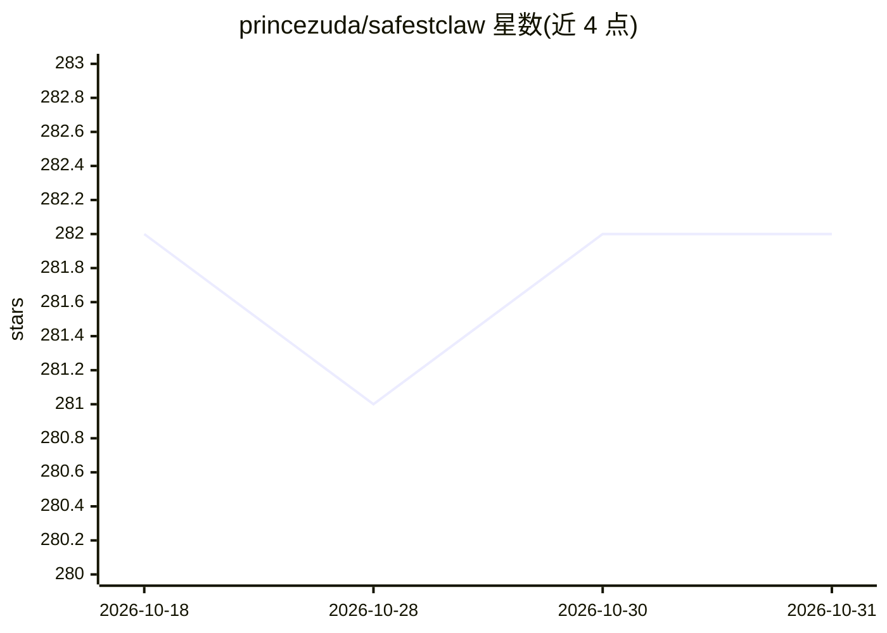

# princezuda/safestclaw

⭐ 282 · Python · MIT · 推送 2026-09-22 · [GitHub](https://github.com/princezuda/safestclaw) · 个人维护

**个人 AI 助手：可全程不用 LLM，本地离线运行**

自托管的命令行/Telegram/Web 多通道个人助手，自称 OpenClaw 的零成本替代。默认以规则解析与既有 ML 方案（Whisper STT、Piper TTS、VADER 情感、抽取式摘要、YOLO、OCR 等）完成天气、新闻聚合、社媒摘要、博客、代码安全扫描等动作，不依赖 LLM；LLM 为可选项，支持 Anthropic/OpenAI/Google/Groq 或经 setup 命令自动安装 Ollama 本地运行。动作可经 FastMCP 作为 MCP 工具暴露，研究功能提供 arXiv/Semantic Scholar/Wolfram 两阶段管线。需通过 /help 文档学习命令，自由聊天与浏览器自动化不支持。

## 筛选速览

| 维度 | 判定 | 备注 |
|---|---|---|
| AI 角色 | `ai-native` | 本体是模型或模型工具 |
| 许可风险 | `permissive` | MIT |
| 部署形态 | `self-host` | docker 或自建部署 |
| 模型依赖 | local-ok | 支持本地模型 |
| 硬件要求 | — | 无带数字的原话,不猜 |
| 安装摩擦 | `low` | 无编译、无系统依赖或容器化 |
| 成熟度 | — | 结构信号不足 |

## 能力要点

- 默认零 LLM、零 API 费用，核心功能离线可用
- Whisper/Piper 本地语音输入输出
- 每个动作封装为 MCP 工具（FastMCP，stdio/SSE/HTTP）
- setup ai local 一条命令自动安装 Ollama 并下载模型

## 适用场景

- 不付 API 费用、本地离线地运行个人助手完成日常任务
- 经 CLI、Telegram、localhost Web UI 或 MCP 客户端调用助手动作
- 聚合 50+ RSS 源与社媒账号做摘要和每日简报

## 场景标签

`AI 助手` `语音识别` `语音合成` · 领域:对话与助手

## 证据(README 行号)

> L3: **The zero-cost alternative to OpenClaw. No LLM required, though it is optional. No required API bills. Minimal atta
> L5: You can simply type pip install safestclaw and it will download, please read install.md to understand what to do. Yo
> L180: * **Or go local** — `setup ai local` auto-installs Ollama, downloads a model, configures SafestClaw

## 星数曲线

2026-10-18 282 → 2026-10-31 282（+0）

---
*卡片 v1 · prompt 1.4 · 生成 2026-10-22 · 置信度 mid · 依据 README sha `f115f2e3cecc` · [字段定义](../../DATASET.md)*
