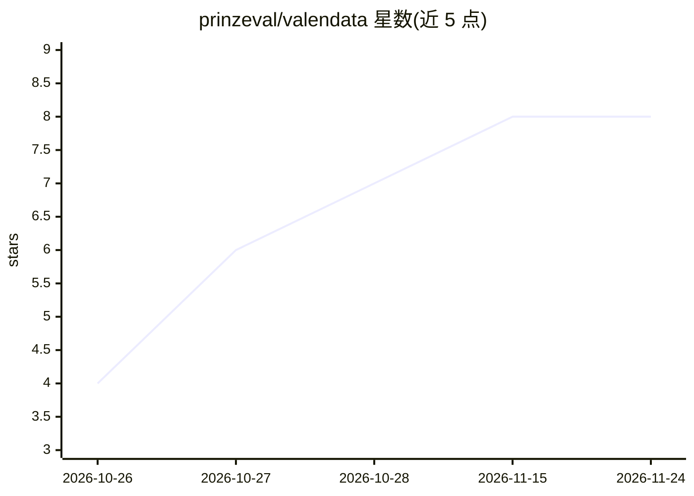

# prinzeval/valendata

⭐ 8 · JavaScript · MIT · 推送 2026-10-27 · [GitHub](https://github.com/prinzeval/valendata) · [官网](https://www.valendata.com) · 个人维护

**给 AI agent 提供网页数据抓取 API 的 MCP 服务与技能包**

面向 Claude Code、Codex、Cursor 等编码 agent 的 MCP 服务器与技能套件：内置 Google Maps、Amazon、eBay、Zillow 等站点的现成抓取技能，可为任意新站点即时创建技能，并在站点改版后自动修复输出结构。同时提供 scrape/crawl/map/search 等 Firecrawl 命名兼容的网页工具、含 Gmail/Slack/Sheets 集成的工作流、最高 1 万条输入的批处理。运行可选云端浏览器或用户自有 Chrome 扩展，按 credit 计费，每月赠 100 免费 credit。

## 筛选速览

| 维度 | 判定 | 备注 |
|---|---|---|
| AI 角色 | `ai-ecosystem` | LLM/agent 周边工具 |
| 许可风险 | `permissive` | MIT |
| 部署形态 | `library` | 以包/库形式分发 |
| 模型依赖 | — | README 未给出锁定关系 |
| 硬件要求 | — | 无带数字的原话,不猜 |
| 安装摩擦 | `low` | 无编译、无系统依赖或容器化 |
| 成熟度 | — | 结构信号不足 |

## 能力要点

- 自修复技能：站点改版后保持相同输出字段
- Firecrawl 与 Apify 兼容接口，可指向官方 SDK 使用
- 支持批量运行（单批最多 10,000 条输入）与定时/webhook 工作流
- 支持云端浏览器或用户自有 Chrome 扩展两种运行方式

## 适用场景

- 让编码 agent 从 Google Maps、Amazon 等站点抓取结构化数据
- 定期抓取职位/房源等信息并推送到 Slack
- 为没有现成抓取器的网站按需生成技能
- 通过 Firecrawl SDK 或 apify-client 从代码调用网页抓取

## 场景标签

`网页抓取` · 领域:效率与自动化

## 证据(README 行号)

> L3: **Give your coding agent the web as an API.** Ask Claude Code, Codex or Cursor for data from any website, and get cl
> L21: **The web, page by page.** Scrape a page to Markdown, crawl a site, map its URLs, search the web, or pull structure
> L109: - **Apify-compatible:** point `apify-client` at `https://api.valendata.com/apify`. Popular actor IDs such as `comp

## 星数曲线

2026-10-26 4 → 2026-11-24 8（+4）

---
*卡片 v1 · prompt 1.4 · 生成 2026-11-20 · 置信度 high · 依据 README sha `e7e9008c5d01` · [字段定义](../../DATASET.md)*
