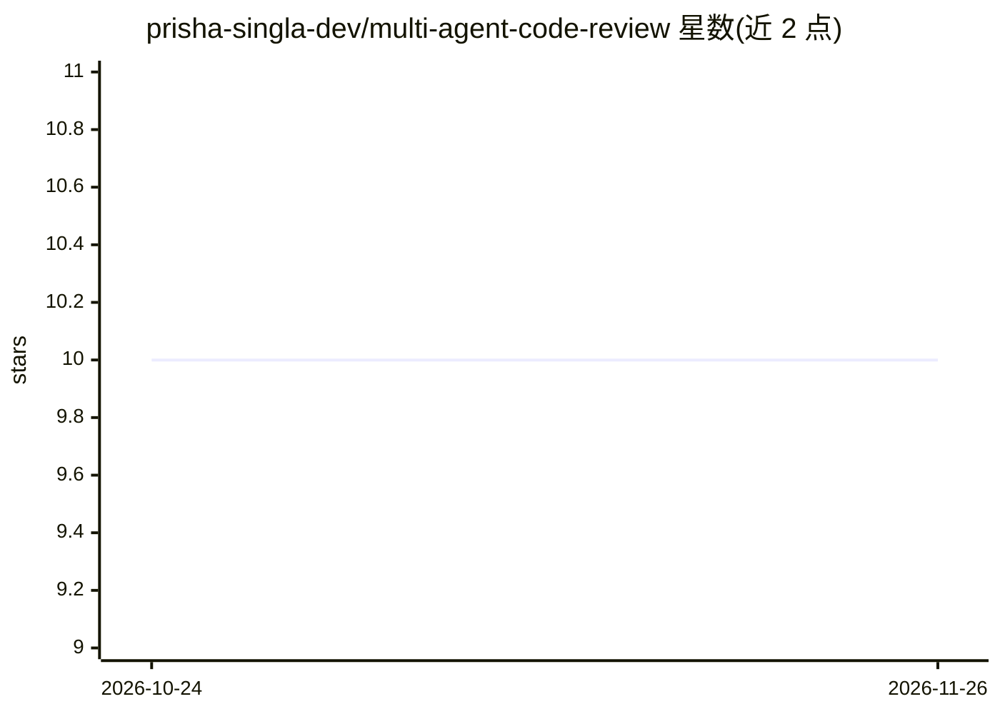

# prisha-singla-dev/multi-agent-code-review

⭐ 10 · Python · 推送 2026-06-26 · [GitHub](https://github.com/prisha-singla-dev/multi-agent-code-review) · [官网](https://multi-agent-code-review-iota.vercel.app) · 个人维护

**用 4 个并行 AI agent 对代码/PR 做结构化审查**

CodeSentinel 是一个多智能体代码审查系统：将粘贴的代码或 GitHub PR 交给 Security、Performance、Logic、Style 四个专项 agent 处理，由合成器汇总为带严重等级、逐行发现和 0-100 评分的最终结论。通过 LangGraph StateGraph 编排流水线，主用 Gemini Flash 系列模型并配置 OpenRouter 免费模型作为回退链，支持 GitHub webhook 自动审查并以 Markdown 评论形式发回 PR。后端 FastAPI、前端 React 18，提供 Vercel/Render 在线演示。

## 筛选速览

| 维度 | 判定 | 备注 |
|---|---|---|
| AI 角色 | `ai-native` | 本体是模型或模型工具 |
| 许可风险 | `none` | — |
| 部署形态 | `library` | 以包/库形式分发 |
| 模型依赖 | — | README 未给出锁定关系 |
| 硬件要求 | — | 无带数字的原话,不猜 |
| 安装摩擦 | `low` | 无编译、无系统依赖或容器化 |
| 成熟度 | — | 结构信号不足 |

## 能力要点

- 4 个专项审查 agent 加 1 个合成器，输出严重等级与逐行发现
- 7 模型 LLM 回退链（Gemini 2.5/2.0 Flash + 5 个 OpenRouter 免费模型）
- GitHub webhook 集成，PR 打开/同步/重开时自动审查并发评论
- HMAC-SHA256 webhook 签名验证与 per-agent 失败回退

## 适用场景

- 给 GitHub 仓库配置 webhook，让每个 PR 自动收到结构化审查评论
- 粘贴一段代码快速检查 SQL 注入、硬编码密钥等安全问题
- 本地部署一套多 agent 代码审查服务用于学习 LangGraph 编排

## 场景标签

`多智能体` `代码审查` · 领域:Agent 开发

## 证据(README 行号)

> L17: CodeSentinel runs your code through 4 independent AI agents, each specializing in a different review dimension. A *
> L39: - **7-model LLM fallback chain** — Gemini 2.5 Flash → Gemini 2.0 Flash → 5 OpenRouter free models, so it never goes

## 星数曲线

2026-10-24 10 → 2026-11-26 10（+0）

---
*卡片 v1 · prompt 1.4 · 生成 2026-11-19 · 置信度 high · 依据 README sha `ab2ba2fa4986` · [字段定义](../../DATASET.md)*
