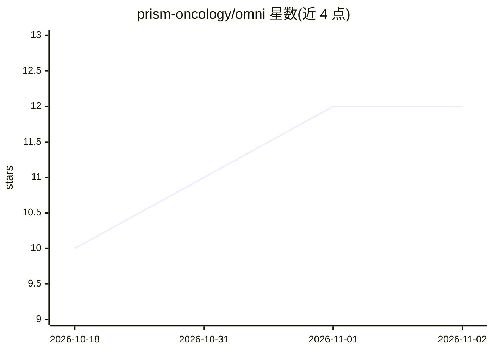

# prism-oncology/omni

⭐ 12 · Python · 推送 2026-10-19 · [GitHub](https://github.com/prism-oncology/omni) · [官网](https://sofiene-boutaj.github.io/omni/) · 组织维护

**数字病理多教师蒸馏视觉编码器（10 个病理基础模型合一）**

OMNI 将 10 个病理基础模型蒸馏为单一紧凑视觉编码器：学生为每个教师学习一个 token，结合结构化注意力掩码、MoE 层与逐教师对比损失。提供 4 个规模预训练权重（7.3M–330M），在 39 个 tile/slide 级任务上评估。仓库含训练代码（单 GPU bf16，约 40 H100 GPU 小时）、基于 WebDataset 的数据构建脚本（配合 TRIDENT/CLAM 提取的特征）及 THUNDER 复现评测脚本；另发布约 11.7k 张 TCGA/CPTAC 全切片的预提取特征。需 Python 3.10+，源码安装。

## 筛选速览

| 维度 | 判定 | 备注 |
|---|---|---|
| AI 角色 | `ai-native` | 本体是模型或模型工具 |
| 许可风险 | `none` | — |
| 部署形态 | `library` | 以包/库形式分发 |
| 模型依赖 | — | README 未给出锁定关系 |
| 硬件要求 | — | 无带数字的原话,不猜 |
| 安装摩擦 | `medium` | 含编译或系统依赖之一 |
| 成熟度 | — | 结构信号不足 |

## 能力要点

- 10 个病理基础模型蒸馏为单个紧凑编码器，每教师一个 token
- 提供 OMNI-T/S/B/L 四档预训练权重（Hugging Face Hub）
- 发布约 11.7k 张 TCGA/CPTAC 全切片的多编码器预提取特征
- THUNDER 评测脚本使论文 tile 级结果可复现

## 适用场景

- 数字病理 tile/slide 级任务的嵌入提取与基准评测
- 复现论文的多教师蒸馏训练或扩展教师子集做 scaling 研究
- 直接下载预提取特征做 MIL 等 slide 级任务，免下原始切片

## 场景标签

`模型训练` · 领域:训练与推理

## 证据(README 行号)

> L11: OMNI distills **10 pathology foundation models** into a single compact vision encoder. Instead of compressing all t
> L58: model = AutoModel.from_pretrained("sofieneb/omni-base", trust_remote_code=True).eval()

## 星数曲线

2026-10-18 10 → 2026-11-02 12（+2）

---
*卡片 v1 · prompt 1.4 · 生成 2026-11-01 · 置信度 high · 依据 README sha `2992dde2c640` · [字段定义](../../DATASET.md)*
