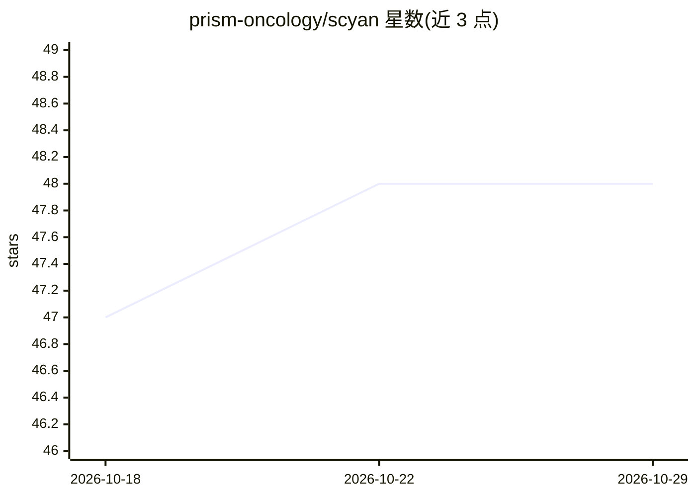

# prism-oncology/scyan

⭐ 48 · Python · BSD-3-Clause · 推送 2026-07-08 · [GitHub](https://github.com/prism-oncology/scyan) · [官网](https://prism-oncology.github.io/scyan/) · 组织维护

**基于生物学先验的流式细胞术细胞类型注释模型**

Scyan 是用于流式/单细胞细胞术（cytometry）细胞群体注释的贝叶斯深度生成模型：由 normalizing flow 可逆神经网络将细胞表达的潜变量分布映射到经验分布，基于生物学知识先验进行注释，无需训练标签；同时支持批次效应校正、debarcoding、细胞采样与群体发现。模型在潜空间上实现可解释性。面向单细胞组学研究者，pip 安装，附文档与教程，论文发表于 Briefings in Bioinformatics。

## 筛选速览

| 维度 | 判定 | 备注 |
|---|---|---|
| AI 角色 | `ai-native` | 本体是模型或模型工具 |
| 许可风险 | `permissive` | BSD-3-Clause |
| 部署形态 | `library` | 以包/库形式分发 |
| 模型依赖 | — | README 未给出锁定关系 |
| 硬件要求 | — | 无带数字的原话,不猜 |
| 安装摩擦 | `low` | 无编译、无系统依赖或容器化 |
| 成熟度 | — | 结构信号不足 |

## 能力要点

- 无需训练标签的细胞群体注释
- normalizing flow 深度可逆神经网络结构
- 批次效应校正、debarcoding 与群体发现
- 潜空间可解释性

## 适用场景

- 流式细胞术数据的细胞类型自动注释
- 跨批次数据的批次效应校正
- debarcoding 与细胞群体发现分析

## 场景标签

 · 领域:生物信息学/单细胞分析

## 证据(README 行号)

> L13: Based on biological knowledge prior, Scyan provides a fast cell population annotation without requiring any trainin
> L21: Scyan is a Bayesian probabilistic model composed of a deep invertible neural network called a normalizing flow (the

## 星数曲线

2026-10-18 47 → 2026-10-29 48（+1）

---
*卡片 v1 · prompt 1.4 · 生成 2026-10-25 · 置信度 high · 依据 README sha `8b9cd6fe9cc1` · [字段定义](../../DATASET.md)*
