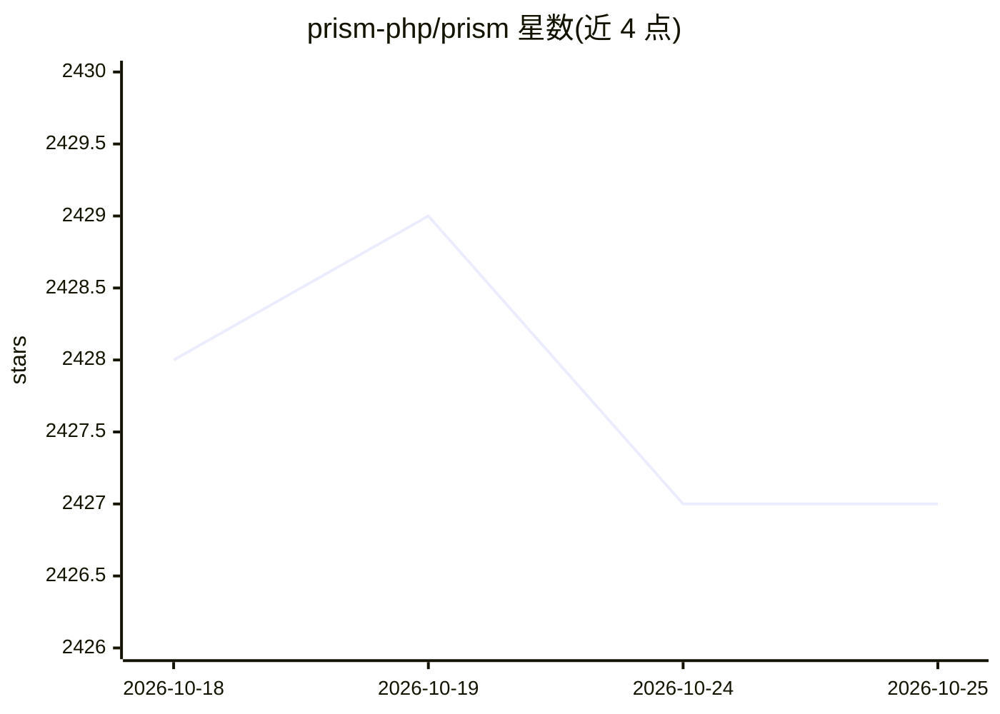

# prism-php/prism

⭐ 2,427 · PHP · MIT · 推送 2026-10-16 · [GitHub](https://github.com/prism-php/prism) · [官网](https://prismphp.com) · 个人维护

**Laravel 应用接入 LLM 的统一接口包**

Prism 是一个 Laravel/PHP 包，为应用集成大语言模型提供统一接口：支持文本生成、多轮对话与工具调用，可对接多种 AI 提供商，让开发者专注构建 AI 应用而无需处理底层技术细节。以 Composer/Packagist 包形式分发，采用 MIT 许可，由 TJ Miller 创建并接受开源社区贡献。官方文档独立发布于 Prism 网站，README 本身未包含安装命令或代码示例。

## 筛选速览

| 维度 | 判定 | 备注 |
|---|---|---|
| AI 角色 | `ai-ecosystem` | LLM/agent 周边工具 |
| 许可风险 | `permissive` | MIT |
| 部署形态 | `None` |  |
| 模型依赖 | — | README 未给出锁定关系 |
| 硬件要求 | — | 无带数字的原话,不猜 |
| 安装摩擦 | `low` | 无编译、无系统依赖或容器化 |
| 成熟度 | — | 结构信号不足 |

## 能力要点

- 为 Laravel 提供接入 LLM 的流式接口
- 支持文本生成、多步对话与工具调用
- 可对接多种 AI 提供商

## 适用场景

- 在 Laravel 应用中集成多种 LLM 提供商
- 构建带工具调用的多步对话功能
- PHP 技术栈团队快速开发 AI 应用

## 场景标签

`模型网关` · 领域:Agent 开发

## 证据(README 行号)

> L13: Prism is a powerful Laravel package for integrating Large Language Models (LLMs) into your applications. It provide

## 星数曲线

2026-10-18 2,428 → 2026-10-25 2,427（-1）

---
*卡片 v1 · prompt 1.4 · 生成 2026-10-21 · 置信度 high · 依据 README sha `5ae4e2fd692b` · [字段定义](../../DATASET.md)*
