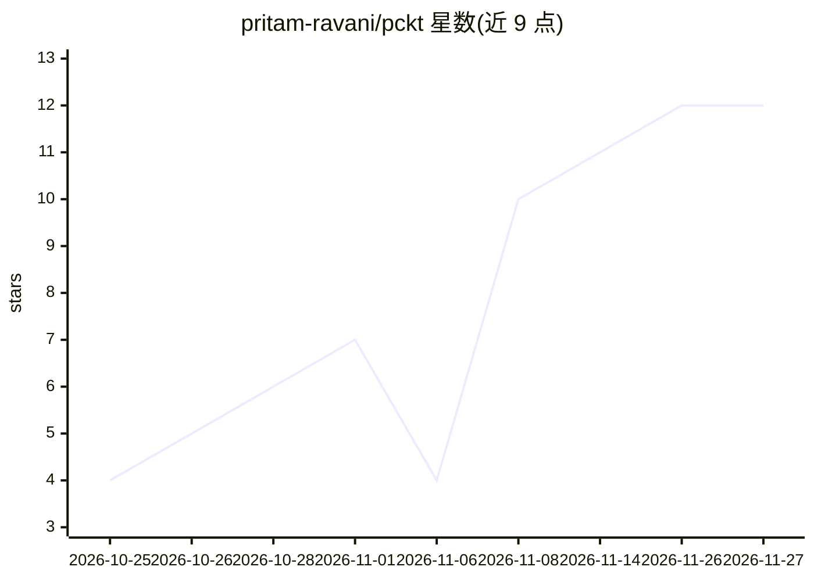

# pritam-ravani/pckt

⭐ 12 · Dart · GPL-3.0 · 推送 2026-10-22 · [GitHub](https://github.com/pritam-ravani/pckt) · [官网](https://github.com/pritam-ravani/pckt/releases/latest) · 个人维护

**面向个人用户的安卓本地记账应用：从银行短信/邮件自动生成账目**

Android 记账应用，读取手机上已有的银行/信用卡/UPI 短信与邮件提醒，经规则解析、去重合并、自动分类生成交易记录，数据存于本地加密数据库，无需账号与服务器。规则解析不了的短信可选交给用户自接的 LLM（OpenAI 兼容 API、Anthropic、Gemini 或手机端 Gemma/Qwen3 模型）；内置带工具调用的 Ask 问答助手，修改前需确认。面向印度场景优先设计（UPI、NACH/IMPS/NEFT），支持 31 种货币。通过 Releases 下载 APK 安装，需授予短信读取权限。

## 筛选速览

| 维度 | 判定 | 备注 |
|---|---|---|
| AI 角色 | `ai-enhanced` | 去掉 AI 部分产品仍成立 |
| 许可风险 | `viral` | GPL-3.0 |
| 部署形态 | `None` |  |
| 模型依赖 | local-ok | 支持本地模型 |
| 硬件要求 | — | 无带数字的原话,不猜 |
| 安装摩擦 | `low` | 无编译、无系统依赖或容器化 |
| 成熟度 | — | 结构信号不足 |

## 能力要点

- 规则解析器读取印度银行短信格式与多币种金额，规则引擎可学习用户分类修正
- 同一笔支付多渠道消息的评分去重合并，可查看与撤销
- 可选 AI：自接 API key 或手机端 Gemma/Qwen3 模型（按 RAM 选型），Ask 代理最多 8 步工具调用
- SQLCipher 加密、生物识别锁、CSV 导出与 JSON 全量备份/恢复

## 适用场景

- 不手动录入、让应用自动从银行短信和邮件生成账目
- 不把财务数据同步到云端的本地记账
- 用对话查询消费情况，如某月餐饮支出对比
- 多币种消费管理（本币汇总+外币保留原币种）

## 场景标签

`数据分析` · 领域:效率与自动化

## 证据(README 行号)

> L21: in. Everything stays in an encrypted database on your phone. If you want AI help, you connect your
> L43: - **Bring your own brain.** Plug in OpenAI-compatible (OpenAI, OpenRouter, Groq, Ollama…),
> L83: - Optional AI: read unusual messages, categorise leftovers, chat with your finances

## 星数曲线

2026-10-25 4 → 2026-11-27 12（+8）

---
*卡片 v1 · prompt 1.4 · 生成 2026-11-18 · 置信度 high · 依据 README sha `88a7818418c4` · [字段定义](../../DATASET.md)*
