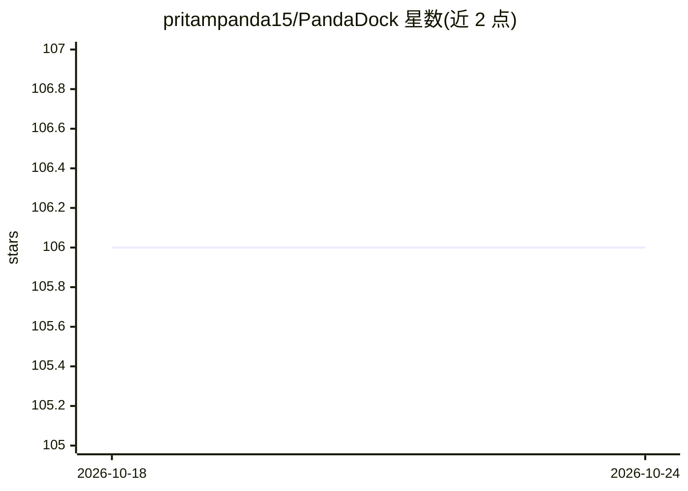

# pritampanda15/PandaDock

⭐ 106 · Python · MIT · 推送 2026-08-24 · [GitHub](https://github.com/pritampanda15/PandaDock) · [官网](https://www.biorxiv.org/content/10.64898/2026.08.19.745667v1) · 个人维护

**分子对接套件：柔性配体搜索 + SE(3) 等变 GNN 亲和力打分**

面向计算化学/药物发现研究者的分子对接工具：对可旋转键做显式构象搜索（SO(3) 均匀采样 + L-BFGS 松弛），配合 AutoDock Vina 函数形式的预计算亲和力网格打分，单次搜索耗时秒到分钟。可选 PandaDock-GNN（SE(3) 等变图神经网络，74 万复合物训练）对给定构象估算亲和力（PDBbind 上 R=0.53），也可对 Vina/Glide/GOLD 产出的构象重打分。支持 CPU 与实验性 GPU 批量搜索（cuda/mps），并提供虚拟筛选模式。限制：GPU 路径为实验性，特殊模式（诱导契合、金属配位等）未做基准测试；不设 --seed 时结果不可复现。

## 筛选速览

| 维度 | 判定 | 备注 |
|---|---|---|
| AI 角色 | `ai-native` | 本体是模型或模型工具 |
| 许可风险 | `permissive` | MIT |
| 部署形态 | `library` | 以包/库形式分发 |
| 模型依赖 | — | README 未给出锁定关系 |
| 硬件要求 | — | 无带数字的原话,不猜 |
| 安装摩擦 | `medium` | 含编译或系统依赖之一 |
| 成熟度 | `idea` | |

## 能力要点

- 柔性配体搜索：所有可旋转键作为显式自由度，解析梯度 L-BFGS 松弛
- PandaDock-GNN：SE(3) 等变亲和力打分，PDBbind 留出集 R=0.53
- 通用重打分器：可对 Vina/Glide/GOLD 等任意对接工具的构象打分
- 实验性 GPU 批量搜索（cuda/mps），815 复合物基准上 A10G 整体提速 8.5 倍

## 适用场景

- 药物发现中做受体-配体分子对接并预测亲和力
- 对 Vina/Glide/GOLD 等工具产出的构象做 GNN 重打分
- 批量虚拟筛选配体库（pandadock screen）
- 用 --seed 固定参数复现对接实验

## 场景标签

 · 领域:计算化学/药物发现

## 证据(README 行号)

> L42: **PandaDock** is a molecular docking suite combining a flexible-ligand
> L65: - **PandaDock-GNN** — SE(3)-equivariant affinity scoring, R = 0.53 on PDBbind

## 星数曲线

2026-10-18 106 → 2026-10-24 106（+0）

---
*卡片 v1 · prompt 1.4 · 生成 2026-10-23 · 置信度 high · 依据 README sha `3379641ae038` · [字段定义](../../DATASET.md)*
