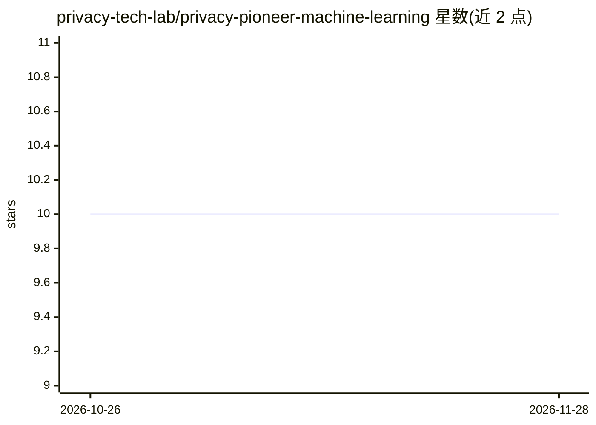

# privacy-tech-lab/privacy-pioneer-machine-learning

⭐ 10 · Jupyter Notebook · MIT · 推送 2026-10-10 · [GitHub](https://github.com/privacy-tech-lab/privacy-pioneer-machine-learning) · [官网](https://www.privacytechlab.org/) · 组织维护

**为 Privacy Pioneer 浏览器扩展提供机器学习数据集与模型**

该仓库收录 Privacy Pioneer 浏览器扩展的全部机器学习内容：训练/验证/测试数据集（城市、区域、经纬度、邮编五类标签）、实验过的所有最终模型链接，以及扩展实际使用的多任务 TinyBERT 模型（59MB，tfjs GraphModel 格式，在浏览器本地运行）。模型用于标注网站向第三方发送数据的五类信息。由 Privacy Pioneer 团队开发维护，训练使用 Hugging Face Transformers、PyTorch、Weights & Biases 与 Google Colab；Python 转 JavaScript 后分类性能平均下降 4.7 个百分点。

## 筛选速览

| 维度 | 判定 | 备注 |
|---|---|---|
| AI 角色 | `ai-native` | 本体是模型或模型工具 |
| 许可风险 | `permissive` | MIT |
| 部署形态 | `None` |  |
| 模型依赖 | — | README 未给出锁定关系 |
| 硬件要求 | — | 无带数字的原话,不猜 |
| 安装摩擦 | `low` | 无编译、无系统依赖或容器化 |
| 成熟度 | — | 结构信号不足 |

## 能力要点

- 最终模型为 TinyBERT 多任务模型，tfjs 格式可在浏览器内运行
- 提供五类标签（IP、区域、经纬度、邮编）的数据集与模型链接
- 模型托管于仓库，用户安装扩展时由此获取

## 适用场景

- 研究浏览器本地运行的隐私分类模型训练流程
- 复现或扩展基于 TinyBERT 的多标签文本分类
- 为浏览器扩展集成轻量化 NLP 模型提供参考

## 场景标签

 · 领域:隐私增强技术/机器学习

## 证据(README 行号)

> L17: This repo contains everything machine learning-related to Privacy Pioneer:
> L34: The Privacy Pioneer extension is structured around distributing information about how websites are taking your data
> L45: We now had a final model that met our requirements, we used Hugging Face and Tensorflow to convert our model (a PyT

## 星数曲线

2026-10-26 10 → 2026-11-28 10（+0）

---
*卡片 v1 · prompt 1.4 · 生成 2026-11-19 · 置信度 high · 依据 README sha `1096e64ab99b` · [字段定义](../../DATASET.md)*
