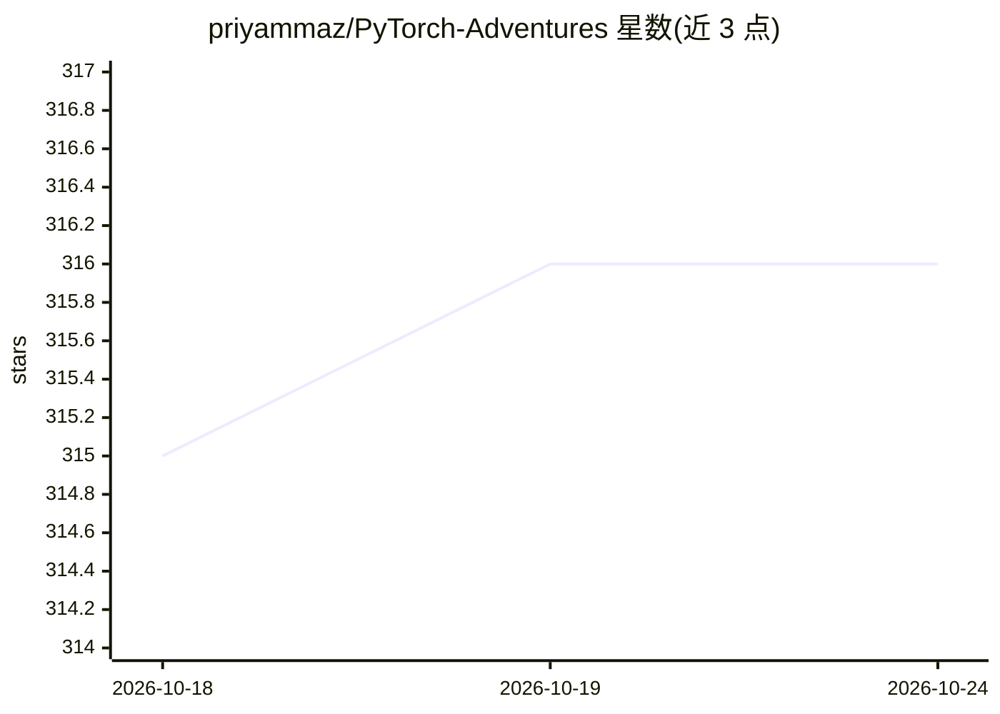

# priyammaz/PyTorch-Adventures

⭐ 316 · Jupyter Notebook · MIT · 推送 2026-09-29 · [GitHub](https://github.com/priyammaz/PyTorch-Adventures) · 个人维护

**面向学习者的 PyTorch 深度学习教程仓库，从零实现到前沿架构**

个人维护的深度学习教学仓库：以 Jupyter Notebook/Colab 形式覆盖 PyTorch 基础、从零手写 AutoGrad 引擎、计算机视觉（ResNet/ViT/UNet/MAE/JEPA）、NLP（GPT/RoBERTa/CLIP/Llama 4）、音频（ASR/TTS/EnCodec）、生成模型（VAE/GAN/扩散）、Transformer 组件与推理优化、强化学习（Q-Learning 到 PPO/SAC）以及 LoRA/蒸馏/TensorRT 等训练加速工具。提供脚本下载 CatsVsDogs/MNIST 等数据集，进阶数据集需手动下载。面向想系统学习深度学习实现细节的开发者与学习者。

## 筛选速览

| 维度 | 判定 | 备注 |
|---|---|---|
| AI 角色 | `ai-knowledge` | 知识聚合/清单类 |
| 许可风险 | `permissive` | MIT |
| 部署形态 | `None` |  |
| 模型依赖 | — | README 未给出锁定关系 |
| 硬件要求 | — | 无带数字的原话,不猜 |
| 安装摩擦 | `low` | 无编译、无系统依赖或容器化 |
| 成熟度 | — | 结构信号不足 |

## 能力要点

- 从零实现 AutoGrad 引擎（ManualGrad/MyTorch）
- 覆盖 CV/NLP/音频/生成模型/强化学习的模型实现教程
- 含注意力机制、位置编码、KV Cache 等 Transformer 组件专题
- LoRA、知识蒸馏、TensorRT、DeepSpeed、Triton 等工具讲解

## 适用场景

- 系统学习 PyTorch 与各类深度学习架构的实现
- 在 Colab 上跟跑模型代码而无需本地 GPU
- 查阅 Transformer 结构与推理优化的实现细节

## 场景标签

`教程课程` · 领域:学习与行业

## 证据(README 行号)

> L12: The greatest aspect of Artificial Intelligence today is its open source nature. Very rarely in history have key tec
> L37: ## Foundations

## 星数曲线

2026-10-18 315 → 2026-10-24 316（+1）

---
*卡片 v1 · prompt 1.4 · 生成 2026-10-21 · 置信度 high · 依据 README sha `fa21ad403f52` · [字段定义](../../DATASET.md)*
