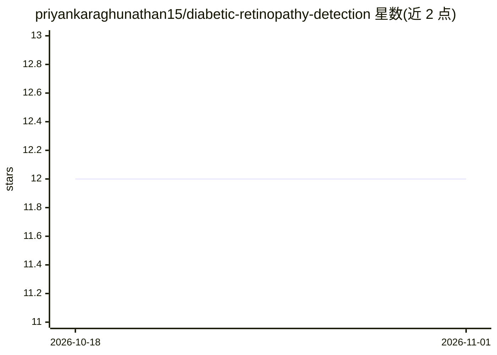

# priyankaraghunathan15/diabetic-retinopathy-detection

⭐ 12 · Jupyter Notebook · 推送 2026-04-07 · [GitHub](https://github.com/priyankaraghunathan15/diabetic-retinopathy-detection) · 个人维护

**基于 EfficientNet 的糖尿病视网膜病变五级分类模型**

面向视网膜眼底图像的深度学习分类项目：以 ImageNet 预训练的 EfficientNetB3 为主干微调，将图像分为无 DR 至增殖期共五个严重程度等级；采用 focal loss 处理类别不平衡，配合数据增强、TensorFlow Dataset 数据管线与早停训练。提供 Grad-CAM 热力图可视化模型关注区域，训练与验证使用公开的 APTOS 2019 数据集，可下载预训练 .keras 模型与训练产物直接测试。最佳验证准确率约 74%。

## 筛选速览

| 维度 | 判定 | 备注 |
|---|---|---|
| AI 角色 | `ai-native` | 本体是模型或模型工具 |
| 许可风险 | `none` | — |
| 部署形态 | `library` | 以包/库形式分发 |
| 模型依赖 | — | README 未给出锁定关系 |
| 硬件要求 | — | 无带数字的原话,不猜 |
| 安装摩擦 | `low` | 无编译、无系统依赖或容器化 |
| 成熟度 | — | 结构信号不足 |

## 能力要点

- EfficientNetB3 五级 DR 分类，focal loss 缓解类别不平衡
- Grad-CAM 热力图解释预测关注区域
- 提供预训练 .keras 模型与训练历史等产物下载
- 训练/推理脚本与 requirements.txt，可复现流水线

## 适用场景

- 对视网膜眼底图像做 DR 严重程度分级预测
- 用 Grad-CAM 检查模型关注的眼底病灶区域
- 作为医用影像分类与类别不平衡处理的参考实现

## 场景标签

`目标检测` · 领域:感知与多模态

## 证据(README 行号)

> L5: This project presents an advanced deep learning solution leveraging **EfficientNet** and convolutional neural networ
> L9: - **Five-class classification:** No DR, Mild, Moderate, Severe, and Proliferative DR

## 星数曲线

2026-10-18 12 → 2026-11-01 12（+0）

---
*卡片 v1 · prompt 1.4 · 生成 2026-11-01 · 置信度 mid · 依据 README sha `984ea927f06d` · [字段定义](../../DATASET.md)*
