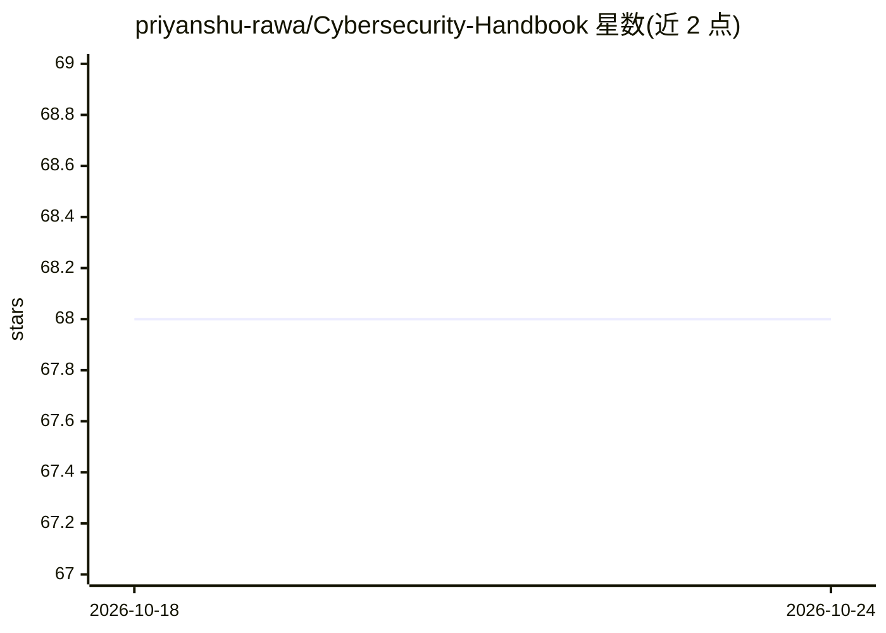

# priyanshu-rawa/Cybersecurity-Handbook

⭐ 68 · JavaScript · MIT · 推送 2026-10-20 · [GitHub](https://github.com/priyanshu-rawa/Cybersecurity-Handbook) · [官网](https://cybersecurity-handbook-lake.vercel.app) · 个人维护

**网络安全学习知识库：400+ 笔记与实验室，可交互知识图谱导航**

基于 Quartz 构建的开源网络安全知识站点，以 Markdown 结构化笔记形式提供 400+ 篇内容，覆盖操作系统与网络、OWASP 等攻防安全、SOC/取证等防御安全、云与基础设施（Docker/Kubernetes/DevSecOps）、脚本编程与密码学。提供全文搜索、笔记间交互式知识图谱、明暗主题与移动端适配；本地运行需 Node.js v18+ 与 npm/yarn，通过 git clone 后 npm install 并运行 Quartz 开发服务，也可构建静态站点部署。

## 筛选速览

| 维度 | 判定 | 备注 |
|---|---|---|
| AI 角色 | `ai-knowledge` | 知识聚合/清单类 |
| 许可风险 | `permissive` | MIT |
| 部署形态 | `library` | 以包/库形式分发 |
| 模型依赖 | — | README 未给出锁定关系 |
| 硬件要求 | — | 无带数字的原话,不猜 |
| 安装摩擦 | `low` | 无编译、无系统依赖或容器化 |
| 成熟度 | — | 结构信号不足 |

## 能力要点

- 400+ 篇结构化笔记，覆盖攻防、云安全、密码学等 6 大领域
- 交互式知识图谱展示笔记间概念关联
- Quartz 全文搜索与明暗主题（Catppuccin Mocha）
- 无需注册/广告/付费即可在线访问

## 适用场景

- 系统自学网络安全，按学习路径从基础到攻防
- 通过知识图谱浏览概念之间的关联
- 作为备考或工作时的速查手册

## 场景标签

`网络安全` `教程课程` · 领域:学习与行业

## 证据(README 行号)

> L7:  An open-source cybersecurity knowledge base for students, professionals, and
> L8:  self-learners — built as structured notes, hands-on labs, and real-world
> L53:  400+ and growing

## 星数曲线

2026-10-18 68 → 2026-10-24 68（+0）

---
*卡片 v1 · prompt 1.4 · 生成 2026-10-24 · 置信度 high · 依据 README sha `bfbafc2e7c97` · [字段定义](../../DATASET.md)*
