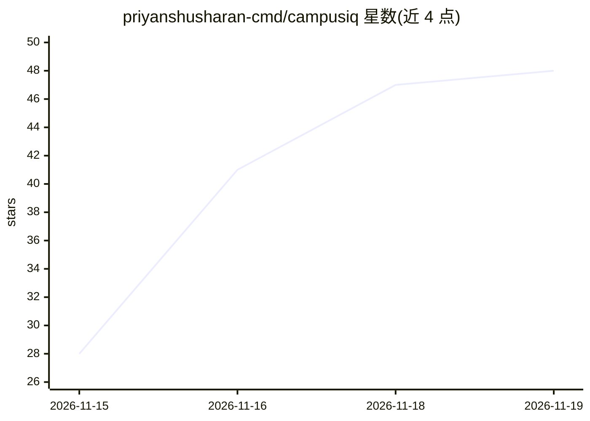

# priyanshusharan-cmd/campusiq

⭐ 48 · TypeScript · MIT · 推送 2026-11-15 · [GitHub](https://github.com/priyanshusharan-cmd/campusiq) · [官网](https://priyanshusharan-cmd.github.io/campusiq/) · 个人维护

**面向大学生的课表/考勤/绩点管理 App，辅以 Gemma AI 导入**

React Native/Expo + TypeScript 的校园伴侣应用：管理周一至周日课表、理论/实验分开的考勤、SGPA/CGPA 成绩单与目标预测、作业与考试倒计时，学术计算为本地纯函数实现。AI 部分由用户自带 Google API key 或自有 Ollama 端点驱动 Gemma，从课表/成绩单截图提取数据生成待审核的导入提案，逐行确认后保存；无后端、无账号，数据留在设备。计算功能（出勤模拟、绩点预测）不依赖 AI，离线可用。提供 Android APK、iOS 侧载 IPA 与 Web 版。

## 筛选速览

| 维度 | 判定 | 备注 |
|---|---|---|
| AI 角色 | `ai-enhanced` | 去掉 AI 部分产品仍成立 |
| 许可风险 | `permissive` | MIT |
| 部署形态 | `library` | 以包/库形式分发 |
| 模型依赖 | local-ok | 支持本地模型 |
| 硬件要求 | — | 无带数字的原话,不猜 |
| 安装摩擦 | `low` | 无编译、无系统依赖或容器化 |
| 成熟度 | — | 结构信号不足 |

## 能力要点

- Gemma 从课表/成绩单截图提取数据，生成逐行可审核的导入提案
- 学术计算（考勤 what-if、SGPA/CGPA、外部考试目标预测）为本地纯函数，不依赖 AI
- AI 可选云端（Google API）或本地（自有 Ollama 端点），无后端无账号，数据留在设备
- 理论/实验考勤分开跟踪，支持替换范围选择与冲突提示

## 适用场景

- 把群聊里的课表截图导入并管理整学期安排
- 跟踪考勤百分比，计算还能缺几节课或需连上几节
- 维护各学期成绩并预测达标所需的外部考试分数
- 向 AI 助手提问学术问题并审核其提出的数据修改

## 场景标签

`AI 助手` `文档解析` · 领域:对话与助手

## 证据(README 行号)

> L3: **A college companion that turns scattered timetables, attendance records and marksheets into one clear picture of s
> L134: |✨ **AI assistance**|Ask academic questions, attach a timetable or marksheet and prepare supported app changes wit
> L173: CampusIQ's academic engine lives in `src/lib` as small, pure, testable functions. No AI is involved in these calcu

## 星数曲线

2026-11-15 28 → 2026-11-19 48（+20）

---
*卡片 v1 · prompt 1.4 · 生成 2026-11-18 · 置信度 mid · 依据 README sha `de5a2517a1d5` · [字段定义](../../DATASET.md)*
