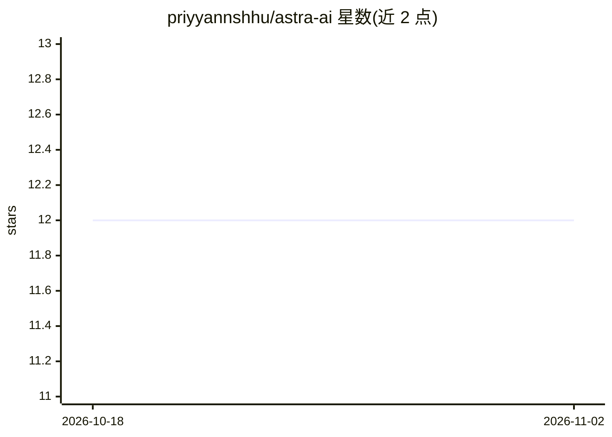

# priyyannshhu/astra-ai

⭐ 12 · JavaScript · 推送 2026-05-07 · [GitHub](https://github.com/priyyannshhu/astra-ai) · [官网](https://astra-aii.vercel.app) · 个人维护

**把自然语言描述转化为可运行 React 应用的 AI 应用构建器**

基于 Next.js 15、React 19、Convex 与 Google Gemini API 构建的 Web 应用：用户输入自然语言描述，经可选的 AI 提示词增强后生成多文件 React/HTML/CSS 项目，通过 Sandpack 提供实时代码编辑与预览，支持对话式迭代修改、工作区历史、导出 ZIP、推送到 GitHub。用户端集成 Google OAuth 登录、Token 用量体系与 PayPal 支付 SDK。部署功能标注为开发中。需自行配置 Convex、Gemini API 等环境变量后本地运行。

## 筛选速览

| 维度 | 判定 | 备注 |
|---|---|---|
| AI 角色 | `ai-native` | 本体是模型或模型工具 |
| 许可风险 | `none` | — |
| 部署形态 | `library` | 以包/库形式分发 |
| 模型依赖 | — | README 未给出锁定关系 |
| 硬件要求 | — | 无带数字的原话,不猜 |
| 安装摩擦 | `low` | 无编译、无系统依赖或容器化 |
| 成熟度 | — | 结构信号不足 |

## 能力要点

- 自然语言生成多文件 React 项目，Sandpack 实时编辑与预览
- AI 提示词增强与对话式迭代修改
- GitHub OAuth 推送代码与 ZIP 导出
- Google OAuth 登录与 Token 用量体系

## 适用场景

- 用自然语言快速搭建计算器、看板、落地页等 Web 应用
- 在对话中持续迭代修改生成的代码
- 把生成的项目直接推送到 GitHub 归档

## 场景标签

`代码生成` · 领域:编码与开发

## 证据(README 行号)

> L5: Astra AI is an intelligent **AI-powered application builder** that converts natural language descriptions into fully
> L100: - **Google Gemini API** - Advanced language model for code generation

## 星数曲线

2026-10-18 12 → 2026-11-02 12（+0）

---
*卡片 v1 · prompt 1.4 · 生成 2026-11-01 · 置信度 high · 依据 README sha `b51108c33707` · [字段定义](../../DATASET.md)*
