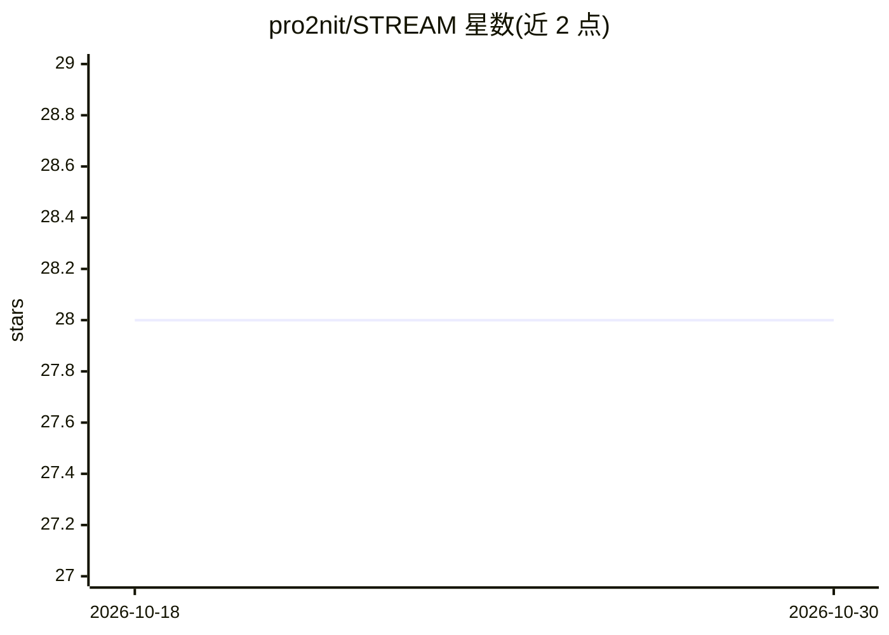

# pro2nit/STREAM

⭐ 28 · Python · MIT · 推送 2025-12-24 · [GitHub](https://github.com/pro2nit/STREAM) · 个人维护

**视频生成模型评估指标：分离评估空间与时间质量**

ICLR 2024 论文 STREAM 的官方实现，Python/PyTorch 库，以 pip 包 v-stream 提供。针对 FVD 偏重空间、受嵌入网络输入长度限制（16 帧）等问题，提出可独立评估视频空间与时间维度的指标 STREAM-T/STREAM-F/STREAM-D，不受视频长度约束。使用方式为读取真实与生成视频的 .npy 数据，经 Skewness 与 mean signal 计算后输出各维度得分。内置 SwAV 与 DINOv2 两种嵌入器，也支持自定义 torch.nn.Module 嵌入器。

## 筛选速览

| 维度 | 判定 | 备注 |
|---|---|---|
| AI 角色 | `ai-ecosystem` | LLM/agent 周边工具 |
| 许可风险 | `permissive` | MIT |
| 部署形态 | `library` | 以包/库形式分发 |
| 模型依赖 | — | README 未给出锁定关系 |
| 硬件要求 | — | 无带数字的原话,不猜 |
| 安装摩擦 | `medium` | 含编译或系统依赖之一 |
| 成熟度 | — | 结构信号不足 |

## 能力要点

- 独立评估视频的时间（STREAM-T）与空间（STREAM-F/STREAM-D）质量
- 不受嵌入网络输入长度限制，支持任意视频长度
- 内置 SwAV / DINOv2 嵌入器，支持自定义嵌入模块
- pip 包 v-stream 安装，pip 一行可用

## 适用场景

- 评估视频生成模型的质量并定位空间或时间维度的缺陷
- 研究者在论文实验中替代或补充 FVD 指标
- 对比真实与生成视频分布的时间自然度

## 场景标签

`模型评测` · 领域:评测与运维

## 证据(README 行号)

> L9: > Image generative models have made significant progress in generating realistic and diverse images, supported by co
> L6: [2024.01.17] - 🎊 **STREAM** has been accepted by ICLR 2024! 🎊

## 星数曲线

2026-10-18 28 → 2026-10-30 28（+0）

---
*卡片 v1 · prompt 1.4 · 生成 2026-10-26 · 置信度 high · 依据 README sha `0cb1da8cb31e` · [字段定义](../../DATASET.md)*
