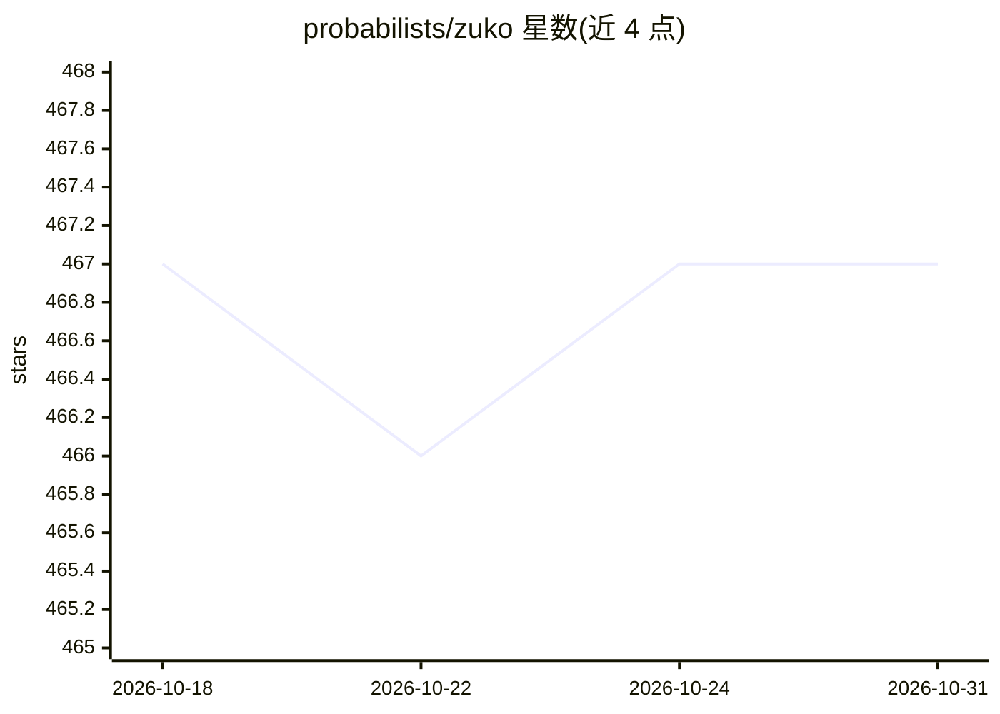

# probabilists/zuko

⭐ 467 · Python · MIT · 推送 2026-10-27 · [GitHub](https://github.com/probabilists/zuko) · [官网](https://zuko.readthedocs.io) · 组织维护

**PyTorch 生态的 normalizing flows 概率建模库**

Zuko 是基于 PyTorch 实现 normalizing flows 的 Python 包，核心机制是 LazyDistribution 与 LazyTransform：通过延迟创建分布/变换，使条件分布可表达，同时保留 nn.Module 的可训练参数与 GPU 迁移能力。提供 12 种流模型（NICE、RealNVP、MAF、NSF、CNF 等）用于密度估计、采样与生成式建模。面向使用 PyTorch 做概率推断的研究者与开发者，文档托管于 readthedocs。

## 筛选速览

| 维度 | 判定 | 备注 |
|---|---|---|
| AI 角色 | `ai-native` | 本体是模型或模型工具 |
| 许可风险 | `permissive` | MIT |
| 部署形态 | `library` | 以包/库形式分发 |
| 模型依赖 | — | README 未给出锁定关系 |
| 硬件要求 | — | 无带数字的原话,不猜 |
| 安装摩擦 | `medium` | 含编译或系统依赖之一 |
| 成熟度 | — | 结构信号不足 |

## 能力要点

- LazyDistribution/LazyTransform 设计支持条件分布
- 实现 12 种 normalizing flows 变体（GMM 至 BPF）
- 模块化设计保留 .to('cuda') 与 .parameters() 能力
- 提供自定义 Flow 对象构建方式

## 适用场景

- 在 PyTorch 中做密度估计与条件分布建模
- 构建并训练 normalizing flows 生成模型
- 实验对比多种流模型结构

## 场景标签

 · 领域:机器学习/概率生成模型

## 证据(README 行号)

> L5: Zuko is a Python package that implements normalizing flows in PyTorch. It relies as much as possible on distribution
> L7: To solve these problems, `zuko` defines two concepts: the `LazyDistribution` and `LazyTransform`, which are any modu
> L31: Normalizing flows are provided in the `zuko.flows` module. To build one, supply the number of sample and context fe

## 星数曲线

2026-10-18 467 → 2026-10-31 467（+0）

---
*卡片 v1 · prompt 1.4 · 生成 2026-10-21 · 置信度 high · 依据 README sha `ef75603731f6` · [字段定义](../../DATASET.md)*
