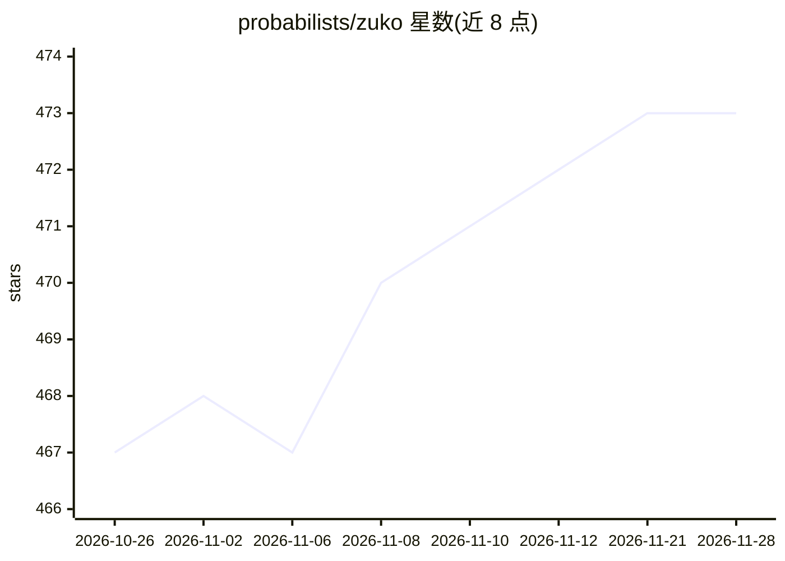

# probabilists/zuko

⭐ 473 · Python · MIT · 推送 2026-10-27 · [GitHub](https://github.com/probabilists/zuko) · [官网](https://zuko.readthedocs.io) · 组织维护

**给概率推断研究者的 PyTorch 归一化流库**

Zuko 是在 PyTorch 中实现归一化流的 Python 包，尽量复用 PyTorch 已有的分布与变换类。它定义 LazyDistribution 与 LazyTransform 两个概念，使分布创建延迟、可表达条件分布/变换，并保留模块的可训练参数与 GPU 迁移能力。内置 17 种流实现（NICE、RealNVP、MAF、Neural Spline Flows、CNF 等），提供 zuko.flows 模块与自定义 Flow 构建方式，文档与教程位于 zuko.readthedocs.io。安装经由 PyPI 或 GitHub 仓库源码。

## 筛选速览

| 维度 | 判定 | 备注 |
|---|---|---|
| AI 角色 | `ai-native` | 本体是模型或模型工具 |
| 许可风险 | `permissive` | MIT |
| 部署形态 | `library` | 以包/库形式分发 |
| 模型依赖 | — | README 未给出锁定关系 |
| 硬件要求 | — | 无带数字的原话,不猜 |
| 安装摩擦 | `medium` | 含编译或系统依赖之一 |
| 成熟度 | — | 结构信号不足 |

## 能力要点

- 定义 LazyDistribution/LazyTransform，支持条件分布 p(x|c) 的求值与采样
- 内置 17 种归一化流实现（NICE、RealNVP、MAF、NSF、CNF 等）
- 尽量复用 PyTorch 原生 Distribution/Transform 类，易于理解与扩展
- 提供 PyPI 安装与文档教程

## 适用场景

- 概率推断中的条件密度估计
- 用 PyTorch 训练归一化流生成模型
- 按需采样与评估条件分布

## 场景标签

 · 领域:机器学习/生成模型

## 证据(README 行号)

> L3: # Zuko - Normalizing flows in PyTorch
> L5: Zuko is a Python package that implements normalizing flows in PyTorch. It relies as much as possible on distribution

## 星数曲线

2026-10-26 467 → 2026-11-28 473（+6）

---
*卡片 v1 · prompt 1.4 · 生成 2026-11-25 · 置信度 high · 依据 README sha `3c03e0abfea3` · [字段定义](../../DATASET.md)*
