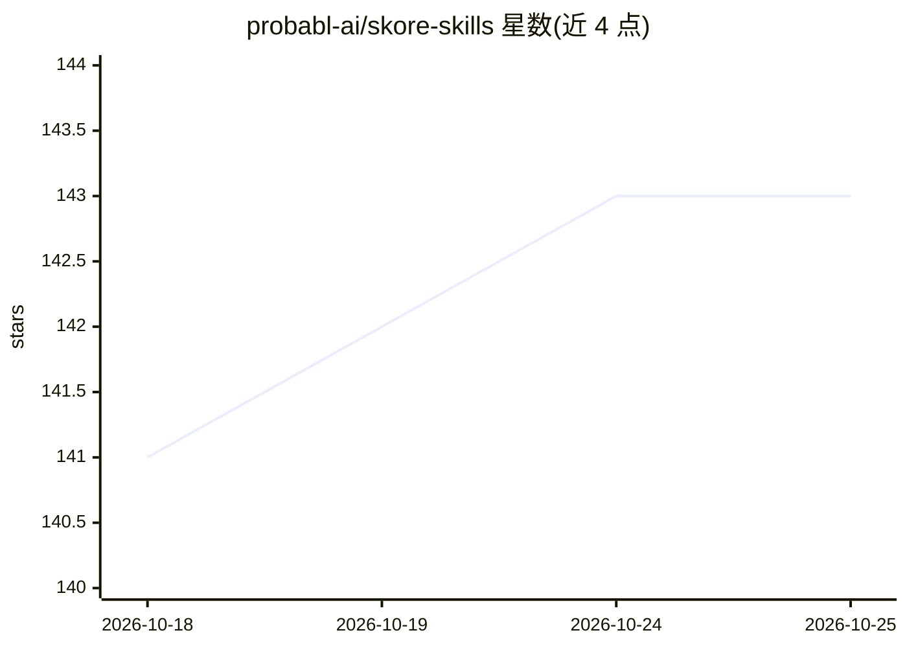

# probabl-ai/skore-skills

⭐ 143 · Python · BSD-3-Clause · 推送 2026-10-23 · [GitHub](https://github.com/probabl-ai/skore-skills) · [官网](https://probabl-ai.github.io/skore-skills/) · 组织维护

**给 AI agent 的表格数据科学技能包，约束 ML 实验方法论**

由 Probabl 维护的 agent 技能集合，用于引导 AI 辅助的机器学习实验：基于 scikit-learn、skrub、skore、pandas、polars 构建流水线，锁定问题框架与验证方案后建模，用 skore 持久化结构化报告以供审计，并连接 Skore Hub 汇总实验。技能按工作流包（setup/data_analysis/model/loop/export）分发，每个技能声明模型层级（small/medium/big）与角色（entry/helper）。安装途径为 PyPI/conda-forge 的 skore 命令、npx、uvx/pixi，以及 Claude Code 插件市场。

## 筛选速览

| 维度 | 判定 | 备注 |
|---|---|---|
| AI 角色 | `ai-ecosystem` | LLM/agent 周边工具 |
| 许可风险 | `permissive` | BSD-3-Clause |
| 部署形态 | `library` | 以包/库形式分发 |
| 模型依赖 | — | README 未给出锁定关系 |
| 硬件要求 | — | 无带数字的原话,不猜 |
| 安装摩擦 | `low` | 无编译、无系统依赖或容器化 |
| 成熟度 | — | 结构信号不足 |

## 能力要点

- 技能覆盖 ML 实验全流程：triage/setup/探索/建模/评估/审计/导出
- 每个技能声明 metadata.modelTier 与 metadata.role，校验脚本强制 helper 不高于调用者层级
- 评估结果持久化为结构化 skore 报告并可同步至 Skore Hub 与 MLflow
- 支持按工作流包 id 选择性安装（setup/data_analysis/model/loop/export）

## 适用场景

- 让 AI agent 按规范流程搭建和管理机器学习实验
- 在实验迭代中留存可审计的结构化评估报告
- 为 Claude Code、OpenCode、Cursor 等 harness 配置数据科学技能

## 场景标签

`数据分析` · 领域:效率与自动化

## 证据(README 行号)

> L3: A set of skills to steer your AI-assisted machine learning experiments.
> L17: Probabl skills let you focus on the science while AI agents handle the implementation,
> L41: As for agent harnesses, we tested them with Claude Code, OpenCode, Cursor, and GitHub

## 星数曲线

2026-10-18 141 → 2026-10-25 143（+2）

---
*卡片 v1 · prompt 1.4 · 生成 2026-10-22 · 置信度 high · 依据 README sha `f55f795e6eb1` · [字段定义](../../DATASET.md)*
