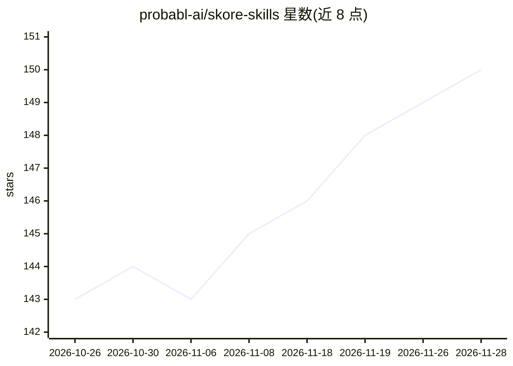

# probabl-ai/skore-skills

⭐ 150 · Python · BSD-3-Clause · 推送 2026-11-20 · [GitHub](https://github.com/probabl-ai/skore-skills) · [官网](https://probabl-ai.github.io/skore-skills/) · 组织维护

**为 AI agent 提供表格数据科学方法论技能集**

面向数据科学工作流的一组 agent 技能（skills），引导 AI agent 按正确方法论构建机器学习 pipeline：使用 scikit-learn、skrub、skore、pandas、polars 等库，覆盖项目初始化、问题定义、数据探索、pipeline 构建、评估、审计、实验记录与文档导出等环节。每个技能声明 modelTier（small/medium/big）与 role，由目录校验脚本约束加载层级；支持按 workflow pack 安装。安装器为 PyPI/conda-forge 上的 skore 命令，也支持 npx 与 Claude Code 插件市场方式。

## 筛选速览

| 维度 | 判定 | 备注 |
|---|---|---|
| AI 角色 | `ai-ecosystem` | LLM/agent 周边工具 |
| 许可风险 | `permissive` | BSD-3-Clause |
| 部署形态 | `library` | 以包/库形式分发 |
| 模型依赖 | — | README 未给出锁定关系 |
| 硬件要求 | — | 无带数字的原话,不猜 |
| 安装摩擦 | `low` | 无编译、无系统依赖或容器化 |
| 成熟度 | — | 结构信号不足 |

## 能力要点

- 覆盖 ML pipeline 全生命周期：framing、build、smoke-test、evaluate、audit 等技能
- 技能声明 modelTier 与 role，tools/validate_catalog.py 强制执行层级约束
- 支持 pip/uv/pixi/uvx/npx 及 Claude Code 插件市场多种安装方式
- 支持按 workflow pack（setup/data_analysis/model/loop/export）选择性安装

## 适用场景

- 让 AI agent 按 ML 最佳实践搭建并迭代表格数据实验
- 统一管理团队数据科学项目的实验记录与审计报告
- 从实验审计摘要出发规划下一轮实验

## 场景标签

`数据分析` · 领域:效率与自动化

## 证据(README 行号)

> L3: A set of skills to steer your AI-assisted machine learning experiments.
> L17: Probabl skills let you focus on the science while AI agents handle the implementation,
> L41: As for agent harnesses, we tested them with Claude Code, OpenCode, Cursor, and GitHub

## 星数曲线

2026-10-26 143 → 2026-11-28 150（+7）

---
*卡片 v1 · prompt 1.4 · 生成 2026-11-27 · 置信度 high · 依据 README sha `5e5b60c5e414` · [字段定义](../../DATASET.md)*
