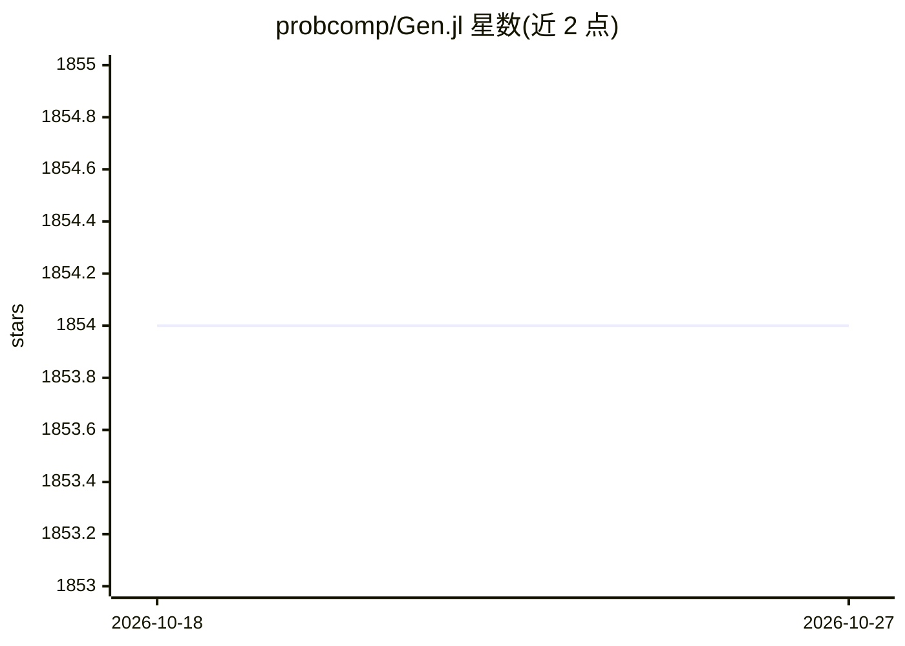

# probcomp/Gen.jl

⭐ 1,854 · Julia · Apache-2.0 · 推送 2026-06-09 · [GitHub](https://github.com/probcomp/Gen.jl) · [官网](https://gen.dev) · 组织维护

**Julia 嵌入的通用概率编程系统，支持可编程推断**

嵌入 Julia 语言的通用概率编程系统：提供表达性建模语言用于编写与组合概率程序，支持多范式贝叶斯推断（SMC、变分推断、MCMC 等）、基于梯度的生成模型训练（参数优化、wake-sleep）、经 involution MCMC 与 SMCP³ 的贝叶斯结构学习，以及加速推断的增量计算建模构造。推断算法可编程，用户可自定义 proposal、变分族、MCMC 核与 SMC 更新。通过 Julia 包管理器安装。属 MIT 概率计算项目的研究软件，附 2019 PLDI 论文。

## 筛选速览

| 维度 | 判定 | 备注 |
|---|---|---|
| AI 角色 | `ai-native` | 本体是模型或模型工具 |
| 许可风险 | `permissive` | Apache-2.0 |
| 部署形态 | `None` |  |
| 模型依赖 | — | README 未给出锁定关系 |
| 硬件要求 | — | 无带数字的原话,不猜 |
| 安装摩擦 | `low` | 无编译、无系统依赖或容器化 |
| 成熟度 | — | 结构信号不足 |

## 能力要点

- 多范式贝叶斯推断：SMC、变分推断、MCMC 等
- 可编程推断：自定义 proposal、变分族、MCMC 核、SMC 更新
- 基于梯度的生成模型训练与贝叶斯结构学习
- 支持增量计算加速推断的专用建模构造

## 适用场景

- 在 Julia 中编写与组合概率生成模型
- 实现并定制贝叶斯推断算法（MCMC/SMC/变分）
- 开展机器学习与机器人相关研究并引用 PLDI 论文成果

## 场景标签

 · 领域:机器学习/概率编程

## 证据(README 行号)

> L8: A general-purpose probabilistic programming system with programmable inference, embedded in Julia.
> L54: Gen.jl is part of ongoing research at the MIT Probabilistic Computing Project. To get in contact, please email gen-

## 星数曲线

2026-10-18 1,854 → 2026-10-27 1,854（+0）

---
*卡片 v1 · prompt 1.4 · 生成 2026-10-21 · 置信度 high · 依据 README sha `528bd75fb8c5` · [字段定义](../../DATASET.md)*
