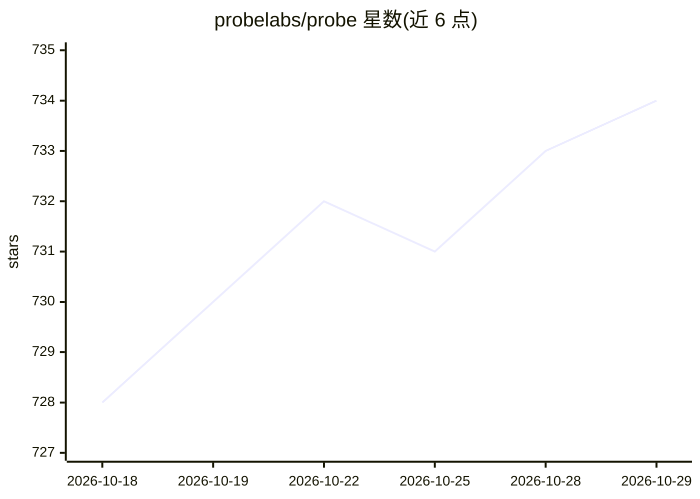

# probelabs/probe

⭐ 734 · Rust · Apache-2.0 · 推送 2026-10-28 · [GitHub](https://github.com/probelabs/probe) · [官网](https://probelabs.com/probe) · 组织维护

**面向 AI 编程助手的语义代码搜索引擎与上下文引擎**

基于 tree-sitter AST 解析与 ripgrep 扫描的代码/Markdown 上下文引擎，面向企业级大规模代码库。提供 Elasticsearch 风格布尔查询、AST 结构匹配（query）、代码块提取与符号列举，无需索引与嵌入模型，结果确定性可复现，搜索完全本地运行。内置多 provider（Anthropic/OpenAI/Google/Bedrock）的 Probe Agent，可通过 MCP 接入 Claude Code 等 AI 编辑器，或以 CLI、Node.js SDK、Vercel AI SDK 工具形式使用。安装途径含 npm、curl 脚本、PowerShell 脚本与 cargo 源码编译。

## 筛选速览

| 维度 | 判定 | 备注 |
|---|---|---|
| AI 角色 | `ai-ecosystem` | LLM/agent 周边工具 |
| 许可风险 | `permissive` | Apache-2.0 |
| 部署形态 | `library` | 以包/库形式分发 |
| 模型依赖 | locked-api |  |
| 硬件要求 | — | 无带数字的原话,不猜 |
| 安装摩擦 | `medium` | 含编译或系统依赖之一 |
| 成熟度 | — | 结构信号不足 |

## 能力要点

- tree-sitter AST 解析，返回完整函数/类而非断裂文本块
- 零索引、无嵌入模型，BM25/TF-IDF/hybrid 排序，支持可选 BERT reranking
- 内置多 provider Agent，支持 MCP、CLI、Node.js SDK 多种接入方式
- LLM Script 沙箱 DSL：AI 生成多步骤搜索/提取/推理流水线

## 适用场景

- 为 AI 编程助手提供精确的代码上下文检索（MCP 接入）
- 在终端直接对大型代码库提问或做结构化代码分析
- 通过 Node.js SDK 在应用中集成代码搜索能力

## 场景标签

`语义搜索` · 领域:知识与检索

## 证据(README 行号)

> L9: **Probe is a context engine built for reading and reasoning.** It treats your code as code—not text. AST parsing und
> L49: Our built-in agent natively integrates with Claude Code, using its authentication—no extra API keys needed.
> L106: - **Built-in Agent**: Multi-provider (Anthropic, OpenAI, Google, Bedrock) with retry, fallback, and context compac

## 星数曲线

2026-10-18 728 → 2026-10-29 734（+6）

---
*卡片 v1 · prompt 1.4 · 生成 2026-10-21 · 置信度 high · 依据 README sha `c292f2c13c72` · [字段定义](../../DATASET.md)*
