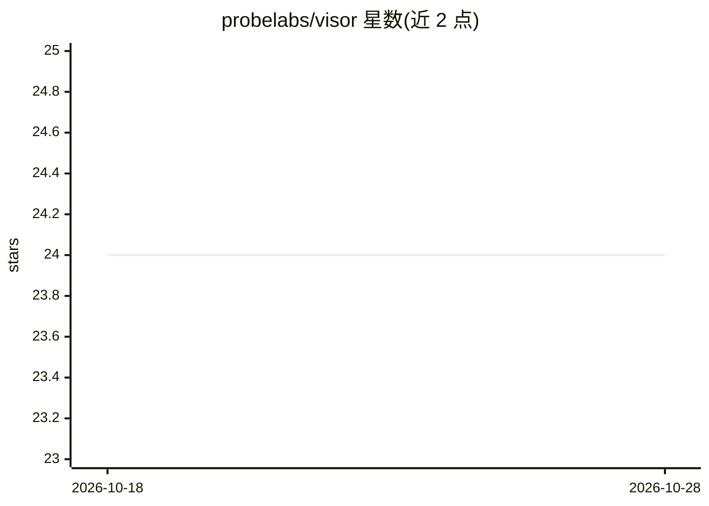

# probelabs/visor

⭐ 25 · TypeScript · MIT · 推送 2026-10-28 · [GitHub](https://github.com/probelabs/visor) · [官网](https://probelabs.com/visor) · 组织维护

**YAML 驱动的 AI 工作流引擎：编排检查、MCP 工具与 AI 供应商**

用 TypeScript 编写的开源工作流引擎：在 YAML 中定义多步骤 AI 管道，将 shell 命令、AI 调用、MCP/UTCP 工具、HTTP 请求与自定义脚本组成依赖 DAG，支持并行波、forEach 扇出、条件路由与失败自动修复。同一配置可运行于 8 种运行时（CLI、GitHub Action、Slack/Telegram/Email/WhatsApp/Teams 机器人、HTTP 服务器）及 TUI、SDK、定时调度模式。内置 assistant/code-talk/intent-router 三个可组合助手工作流，支持 Gemini/Claude/OpenAI/Bedrock 多供应商与会话复用，并提供 YAML 原生集成测试框架。面向需要构建代码审查、AI 助手与自动化的开发者。

## 筛选速览

| 维度 | 判定 | 备注 |
|---|---|---|
| AI 角色 | `ai-ecosystem` | LLM/agent 周边工具 |
| 许可风险 | `permissive` | MIT |
| 部署形态 | `library` | 以包/库形式分发 |
| 模型依赖 | locked-api |  |
| 硬件要求 | — | 无带数字的原话,不猜 |
| 安装摩擦 | `low` | 无编译、无系统依赖或容器化 |
| 成熟度 | — | 结构信号不足 |

## 能力要点

- YAML 定义依赖 DAG 管道，支持并行波、forEach 扇出与失败自动修复
- 8 种运行时模式（CLI/GitHub Action/Slack/Telegram/Email/WhatsApp/Teams/HTTP）共用同一配置
- 17 种 provider 类型，AI 步骤支持 Gemini/Claude/OpenAI/Bedrock 与 MCP 工具调用
- 内置三个助手工作流与 YAML 原生集成测试框架

## 适用场景

- 在 PR 上自动执行代码审查并发布评论
- 构建带技能与工具的多步骤 AI 助手机器人
- 编排 shell 命令、AI 调用与外部工具的自动化管道

## 场景标签

`工作流自动化` `代码审查` `Agent 框架` · 领域:Agent 开发

## 证据(README 行号)

> L9:  Orchestrate checks, MCP tools, and AI providers with YAML-driven pipelines.
> L12: Visor is an open-source workflow engine that lets you define multi-step AI pipelines in YAML. Wire up shell command
> L19: - **AI orchestration** — multi-provider (Gemini, Claude, OpenAI, Bedrock), session reuse, MCP/UTCP tool calling, re

## 星数曲线

2026-10-18 24 → 2026-10-28 24（+0）

---
*卡片 v1 · prompt 1.4 · 生成 2026-10-27 · 置信度 high · 依据 README sha `709307d1fdbb` · [字段定义](../../DATASET.md)*
