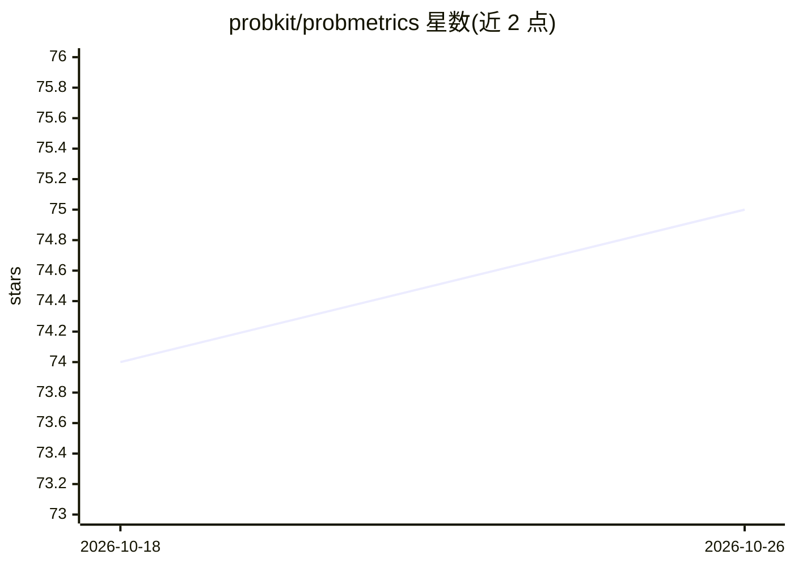

# probkit/probmetrics

⭐ 75 · Python · Apache-2.0 · 推送 2026-05-29 · [GitHub](https://github.com/probkit/probmetrics) · 组织维护

**分类模型的 post-hoc 校准方法与校准度量 Python 库**

基于 PyTorch 的分类预测校准工具包：提供温度缩放、结构化矩阵缩放（SMS/SVS）等 post-hoc 校准方法，并实现 CalArena 基准中的全部校准方法；度量方面提供分类器驱动的 Lp 校准误差变分估计器、refinement 误差、过/欠置信与 top-class 度量。支持 numpy 与 PyTorch 张量（温度缩放可利用 GPU），校准器兼容 scikit-learn 分类器 API。附随四篇论文，回归度量尚不可用。

## 筛选速览

| 维度 | 判定 | 备注 |
|---|---|---|
| AI 角色 | `ai-native` | 本体是模型或模型工具 |
| 许可风险 | `permissive` | Apache-2.0 |
| 部署形态 | `library` | 以包/库形式分发 |
| 模型依赖 | — | README 未给出锁定关系 |
| 硬件要求 | — | 无带数字的原话,不猜 |
| 安装摩擦 | `low` | 无编译、无系统依赖或容器化 |
| 成熟度 | — | 结构信号不足 |

## 能力要点

- 温度缩放与 SMS/SVS 等 post-hoc 校准器，含 get_calibrator 工厂函数
- CalArena 基准全部校准方法的实现
- 分类器驱动的 Lp 校准误差变分估计器与 top-class/过欠置信度量
- numpy 与 PyTorch（GPU 张量）双接口

## 适用场景

- 对已训练分类器的概率输出做事后校准
- 评估模型预测的校准误差与 refinement 误差
- 复现论文中的校准基准实验

## 场景标签

`模型评测` · 领域:评测与运维

## 证据(README 行号)

> L7: - post-hoc calibration methods, in particular:
> L11: - classification metrics, especially metrics for assessing the quality of probabilistic
> L15: It accompanies our papers

## 星数曲线

2026-10-18 74 → 2026-10-26 75（+1）

---
*卡片 v1 · prompt 1.4 · 生成 2026-10-24 · 置信度 high · 依据 README sha `957ce848d4ad` · [字段定义](../../DATASET.md)*
