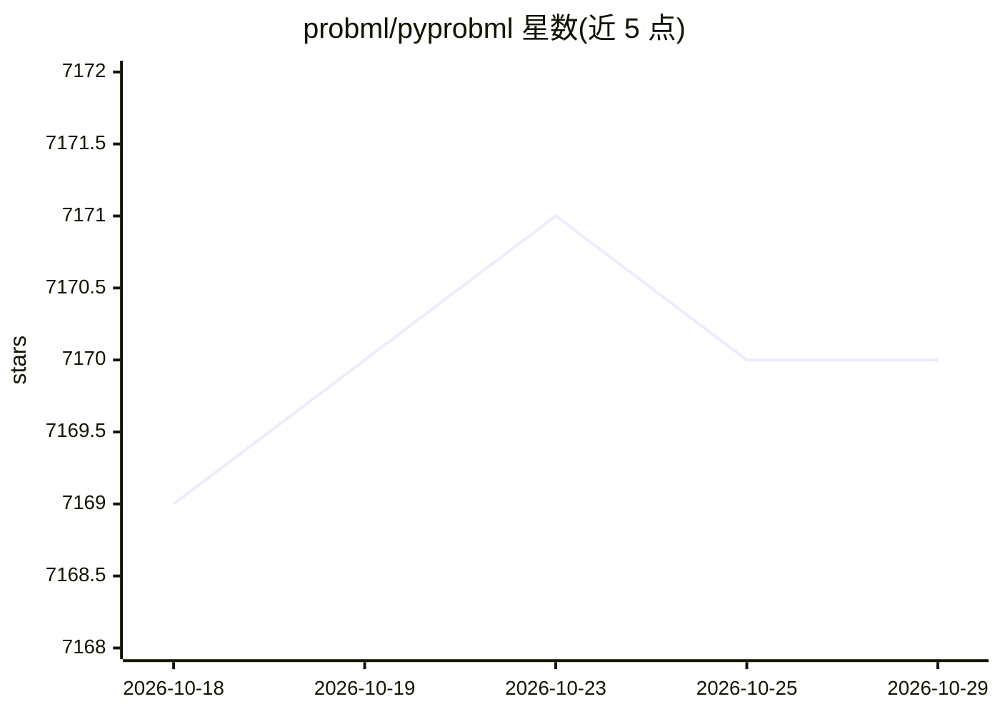

# probml/pyprobml

⭐ 7,170 · Jupyter Notebook · MIT · 推送 2026-10-27 · [GitHub](https://github.com/probml/pyprobml) · 个人维护

**《Probabilistic Machine Learning》两卷教材插图复现代码集**

Kevin Murphy 所著《Probabilistic Machine Learning: An Introduction》与《Advanced Topics》两本书的 Python 3 配套代码，以 Jupyter notebook 形式复现书中全部插图。依赖 numpy、scipy、matplotlib、sklearn 等标准库，部分代码使用 JAX、TensorFlow 2 与 Torch。可在 Colab 直接运行（提供免费 GPU/TPU），也可本地安装 requirements 后运行。仓库自 2022 年 9 月起处于维护模式，不再活跃开发。

## 筛选速览

| 维度 | 判定 | 备注 |
|---|---|---|
| AI 角色 | `ai-knowledge` | 知识聚合/清单类 |
| 许可风险 | `permissive` | MIT |
| 部署形态 | `library` | 以包/库形式分发 |
| 模型依赖 | — | README 未给出锁定关系 |
| 硬件要求 | — | 无带数字的原话,不猜 |
| 安装摩擦 | `low` | 无编译、无系统依赖或容器化 |
| 成熟度 | — | 结构信号不足 |

## 能力要点

- 覆盖两卷书全部插图的 Jupyter notebook 复现代码
- 支持在 Colab 一键运行（预装 scikit-learn、JAX 等）
- 部分代码使用 JAX、TensorFlow 2 与 PyTorch

## 适用场景

- 学习概率机器学习教材时对照运行书中示例代码
- 复现书中图表用于教学或研究
- 查找概率编程（PyMC、Pyro、NumPyro 等）相关示例实现

## 场景标签

`教程课程` · 领域:学习与行业

## 证据(README 行号)

> L3: Python 3 code to reproduce the figures in the books
> L17: As of September 2022, this code is now in maintenance mode.

## 星数曲线

2026-10-18 7,169 → 2026-10-29 7,170（+1）

---
*卡片 v1 · prompt 1.4 · 生成 2026-10-20 · 置信度 high · 依据 README sha `79f29ca97fc6` · [字段定义](../../DATASET.md)*
