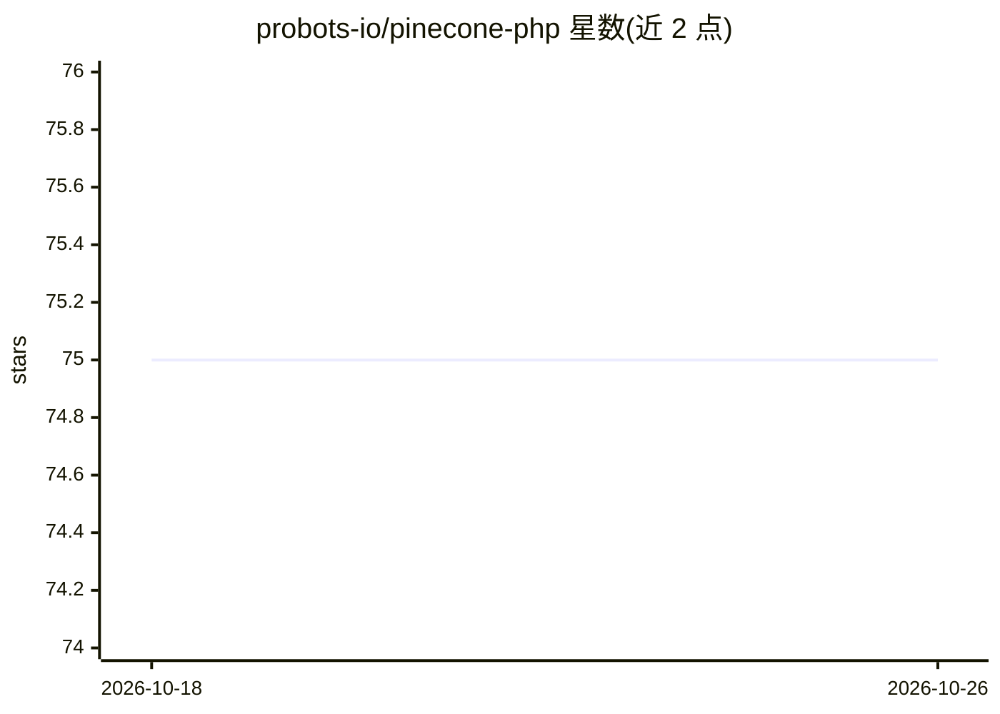

# probots-io/pinecone-php

⭐ 75 · PHP · MIT · 推送 2026-06-23 · [GitHub](https://github.com/probots-io/pinecone-php) · [官网](https://probots.io) · 组织维护

**PHP 开发者的 Pinecone 向量数据库 SDK，封装索引与向量操作**

基于 Saloon 构建的 PHP 客户端库，用于调用 pinecone.io API，覆盖控制面与数据面操作：索引的创建（POD/Serverless）、描述、配置、删除，集合的创建与管理，以及向量的 upsert、query、update、fetch、delete 和索引统计。通过 API Key 认证，响应以 Saloon Response 对象返回。1.x 起使用支持 serverless 的新版 Pinecone API。以 Composer 包分发，MIT 许可。README 待办清单显示参数校验、异常与文档仍在完善中。

## 筛选速览

| 维度 | 判定 | 备注 |
|---|---|---|
| AI 角色 | `ai-ecosystem` | LLM/agent 周边工具 |
| 许可风险 | `permissive` | MIT |
| 部署形态 | `None` |  |
| 模型依赖 | — | README 未给出锁定关系 |
| 硬件要求 | — | 无带数字的原话,不猜 |
| 安装摩擦 | `low` | 无编译、无系统依赖或容器化 |
| 成熟度 | — | 结构信号不足 |

## 能力要点

- 覆盖 Pinecone 控制面（索引/集合）与数据面（向量）全部端点
- 支持创建 POD 与 Serverless 两种索引类型
- 基于 Saloon 构建，响应统一为 Response 对象
- 通过 Composer 一行安装，API Key 认证

## 适用场景

- PHP 项目中接入 Pinecone 管理向量索引
- 在 PHP 应用里执行向量 upsert 与相似度查询
- 用脚本批量管理 Pinecone 集合与索引配置

## 场景标签

`向量数据库` · 领域:知识与检索

## 证据(README 行号)

> L3: A beautiful, extendable PHP Package to communicate with your pinecone.io indices, collections and
> L15: This API provides a feature rich, elegant baseline for working with the pinecone.io API.
> L26: Currently supports all of the available endpoints in the pinecone.io API based

## 星数曲线

2026-10-18 75 → 2026-10-26 75（+0）

---
*卡片 v1 · prompt 1.4 · 生成 2026-10-24 · 置信度 high · 依据 README sha `45db0bba2428` · [字段定义](../../DATASET.md)*
