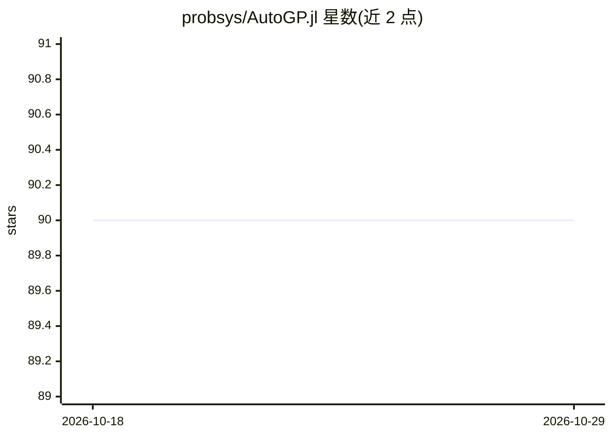

# probsys/AutoGP.jl

⭐ 90 · Julia · Apache-2.0 · 推送 2026-06-19 · [GitHub](https://github.com/probsys/AutoGP.jl) · [官网](https://probsys.github.io/AutoGP.jl/) · 组织维护

**自动发现单变量时间序列高斯过程模型的 Julia 库**

AutoGP 的 Julia 参考实现：对给定单变量时间序列数据，同时学习协方差核函数结构与数值参数，而传统 GP 软件包仅推断用户固定核函数的参数。方法基于 ICML 2023 论文《Sequential Monte Carlo Learning for Time Series Structure Discovery》，可在线发现周期分量、趋势与平滑变化的时间分量。通过 Julia 包管理器安装（需 Julia 1.8+），克隆构建时需设置 JULIA_PROJECT 并构建 PyCall，文档与教程托管在 GitHub Pages。

## 筛选速览

| 维度 | 判定 | 备注 |
|---|---|---|
| AI 角色 | `ai-native` | 本体是模型或模型工具 |
| 许可风险 | `permissive` | Apache-2.0 |
| 部署形态 | `None` |  |
| 模型依赖 | — | README 未给出锁定关系 |
| 硬件要求 | — | 无带数字的原话,不猜 |
| 安装摩擦 | `low` | 无编译、无系统依赖或容器化 |
| 成熟度 | — | 结构信号不足 |

## 能力要点

- 同时学习协方差核函数结构与数值参数（结构学习）
- 在线时间序列结构发现：周期分量、趋势、平滑时间分量
- 基于序列蒙特卡洛（SMC）方法的 ICML 2023 论文参考实现
- Julia 包管理器安装（Julia 1.8+）

## 适用场景

- 分析单变量时间序列并发现其潜在结构分量
- 在不知道协方差核形式时做贝叶斯模型发现
- 复现或扩展 ICML 2023 AutoGP 论文方法

## 场景标签

 · 领域:机器学习/时间序列建模

## 证据(README 行号)

> L8: This package contains the Julia reference implementation of AutoGP, a
> L19: function, AutoGP learns both covariance kernel functions and numeric

## 星数曲线

2026-10-18 90 → 2026-10-29 90（+0）

---
*卡片 v1 · prompt 1.4 · 生成 2026-10-23 · 置信度 high · 依据 README sha `1f1eae7a7faa` · [字段定义](../../DATASET.md)*
