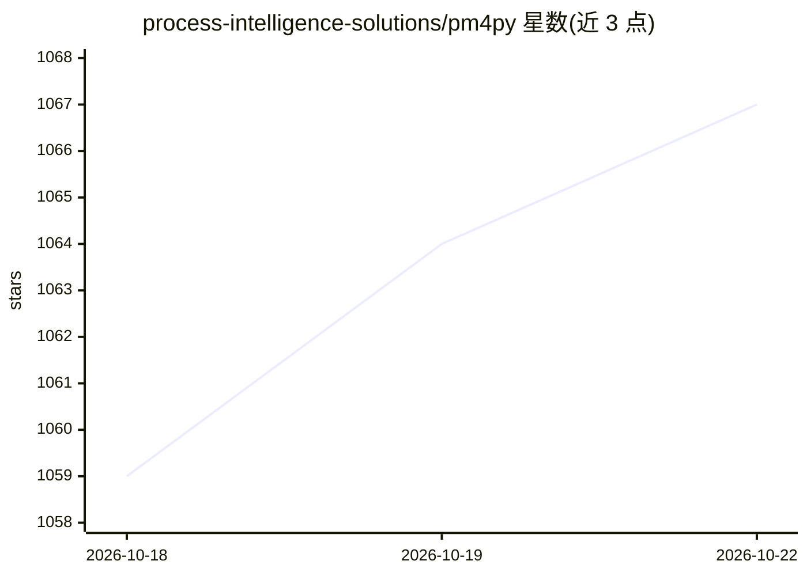

# process-intelligence-solutions/pm4py

⭐ 1,067 · Python · AGPL-3.0 · 推送 2026-10-19 · [GitHub](https://github.com/process-intelligence-solutions/pm4py) · [官网](https://processintelligence.solutions/pm4py) · 组织维护

**Python 过程挖掘库：读取事件日志做过程发现与分析**

PM4Py 是由 PIS（Fraunhofer FIT 衍生公司）维护的开源 Python 过程挖掘库，面向学术与工业项目，提供事件日志（XES）读取、过程发现（如归纳式 Petri 网发现）、过程模型可视化与过滤等算法。可选安装 extras 扩展功能：机器学习（scikit-learn）、Polars 数据框、LLM 集成（openai）、求解器与可视化等。开源版采用 AGPL-3.0，闭源商用需另行获取商业许可。

## 筛选速览

| 维度 | 判定 | 备注 |
|---|---|---|
| AI 角色 | `ai-enhanced` | 去掉 AI 部分产品仍成立 |
| 许可风险 | `viral` | AGPL-3.0 |
| 部署形态 | `library` | 以包/库形式分发 |
| 模型依赖 | — | README 未给出锁定关系 |
| 硬件要求 | — | 无带数字的原话,不猜 |
| 安装摩擦 | `low` | 无编译、无系统依赖或容器化 |
| 成熟度 | — | 结构信号不足 |

## 能力要点

- 读取 XES 事件日志并运行过程发现算法（Petri 网等）
- pip extras 按功能分组安装（ml/polars/llm/ocel 等）
- 支持 Python 3.8–3.14（新版经 pip 安装）
- 开源版 AGPL-3.0，另提供闭源商用商业许可版本

## 适用场景

- 从业务事件日志中发现并可视化过程模型
- 学术研究中做过程挖掘算法实验
- 工业项目中对业务过程做分析与优化

## 场景标签

 · 领域:业务过程挖掘/数据科学

## 证据(README 行号)

> L3: PM4Py is a python library that supports state-of-the-art process mining algorithms in Python.
> L61: * `llm`: openai and requests
> L62: * `ml`: pyemd and scikit-learn

## 星数曲线

2026-10-18 1,059 → 2026-10-22 1,067（+8）

---
*卡片 v1 · prompt 1.4 · 生成 2026-10-21 · 置信度 high · 依据 README sha `ee71c0bb829e` · [字段定义](../../DATASET.md)*
