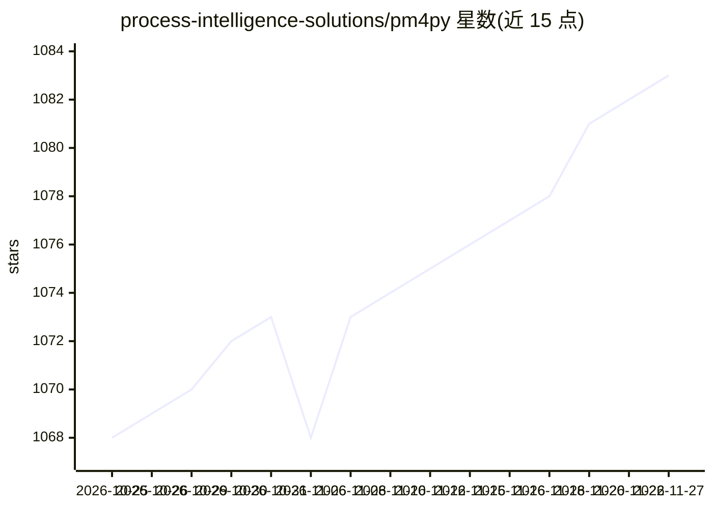

# process-intelligence-solutions/pm4py

⭐ 1,083 · Python · AGPL-3.0 · 推送 2026-11-24 · [GitHub](https://github.com/process-intelligence-solutions/pm4py) · [官网](https://processintelligence.solutions/pm4py) · 组织维护

**Python 过程挖掘库：从事件日志分析业务流程**

PM4Py（Process Mining for Python）是一个开源 Python 库，提供过程挖掘算法与工具，用于探索、分析和优化业务流程，由 Process Intelligence Solutions GmbH 开发维护。安装指南、教程、功能概览与 API 文档托管在其官网。默认安装覆盖主流用法，另在 pyproject.toml 中按功能分组可选依赖（日历、连接器、LLM、机器学习、OCEL、Polars 数据框、求解器、可视化、Windows 支持），stable 额外项锁定经 CI 验证的版本。SciPy 为默认 LP 求解器，PuLP 可选；库以 AGPL-3.0 许可发布，支持学术引用（附论文与 BibTeX）。

## 筛选速览

| 维度 | 判定 | 备注 |
|---|---|---|
| AI 角色 | `ai-enhanced` | 去掉 AI 部分产品仍成立 |
| 许可风险 | `viral` | AGPL-3.0 |
| 部署形态 | `library` | 以包/库形式分发 |
| 模型依赖 | — | README 未给出锁定关系 |
| 硬件要求 | — | 无带数字的原话,不猜 |
| 安装摩擦 | `low` | 无编译、无系统依赖或容器化 |
| 成熟度 | — | 结构信号不足 |

## 能力要点

- 过程挖掘算法与工具的 Python 库实现
- 按功能分组的可选依赖体系（llm/ml/polars/ocel 等）
- 支持 Polars 1.40.1 与 2.x，含流式引擎下的保序过滤
- 提供论文引用信息与第三方依赖许可清单

## 适用场景

- 从业务系统事件日志中发现和分析流程模型
- 对业务流程进行一致性与性能检查以支持优化
- 在数据科学工作流中以 Python 处理过程挖掘任务

## 场景标签

 · 领域:数据挖掘/业务流程分析

## 证据(README 行号)

> L8: PM4Py is a Python library providing state-of-the-art algorithms and tools for process mining.
> L31: |`llm`|openai, requests|
> L32: |`ml`|pyemd, scikit-learn|

## 星数曲线

2026-10-25 1,068 → 2026-11-27 1,083（+15）

---
*卡片 v1 · prompt 1.4 · 生成 2026-11-24 · 置信度 mid · 依据 README sha `941e9f72d723` · [字段定义](../../DATASET.md)*
