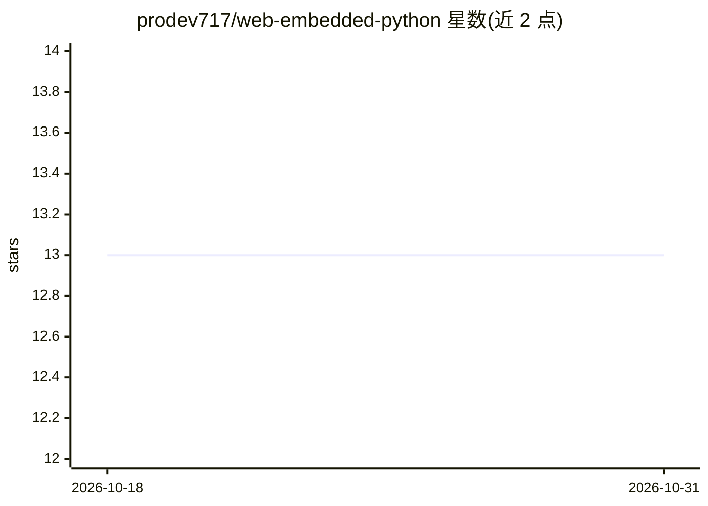

# prodev717/web-embedded-python

⭐ 13 · HTML · MIT · 推送 2025-12-05 · [GitHub](https://github.com/prodev717/web-embedded-python) · [官网](https://web-embedded-python.netlify.app/) · 个人维护

**在 HTML 中嵌入原生 Python 的轻量模板引擎与微框架**

受 PHP 启发的服务端模板引擎：通过 .wep 文件和 <wep> 标签在 HTML 中直接嵌入 Python 代码，用 echo() 输出内容，底层基于 Flask 构建。提供 _GET/_POST/_FILES/GLOBAL/SESSION 等特殊变量处理请求与会话。安装方式为 git clone 源码后用 uv 添加依赖并运行 main.py，访问 localhost:8000。限制：标签内 Python 代码须零缩进、不支持嵌套 <wep> 标签，README 称适合轻量服务端逻辑。

## 筛选速览

| 维度 | 判定 | 备注 |
|---|---|---|
| AI 角色 | `ai-enhanced` | 去掉 AI 部分产品仍成立 |
| 许可风险 | `permissive` | MIT |
| 部署形态 | `library` | 以包/库形式分发 |
| 模型依赖 | — | README 未给出锁定关系 |
| 硬件要求 | — | 无带数字的原话,不猜 |
| 安装摩擦 | `low` | 无编译、无系统依赖或容器化 |
| 成熟度 | — | 结构信号不足 |

## 能力要点

- <wep> 标签在 HTML 中直接嵌入 Python，echo() 输出内容
- 底层基于 Flask，提供 _GET/_POST/_FILES/SESSION 等请求与会话变量
- git clone + uv 安装，uv run main.py 即可运行
- README 称适合原型、教学与服务端渲染站点

## 适用场景

- 不分离前后端地快速原型一个动态网页
- 教学演示 Python 服务端渲染
- 搭建轻量服务端逻辑的小型站点

## 场景标签

 · 领域:Web 开发/模板引擎

## 证据(README 行号)

> L3: > **WEP** is a lightweight server-side template engine and micro-framework that lets you embed native Python directl
> L9: * ✅ Built with Flask under the hood

## 星数曲线

2026-10-18 13 → 2026-10-31 13（+0）

---
*卡片 v1 · prompt 1.4 · 生成 2026-10-31 · 置信度 low · 依据 README sha `3dfcbf99ddf0` · [字段定义](../../DATASET.md)*
