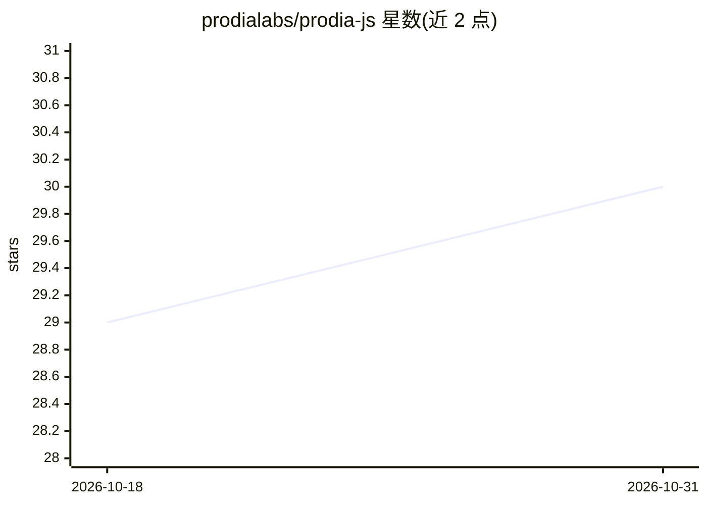

# prodialabs/prodia-js

⭐ 30 · TypeScript · 推送 2026-08-31 · [GitHub](https://github.com/prodialabs/prodia-js) · [官网](https://prodia.com) · 组织维护

**Prodia AI 图像生成 API 的官方 TypeScript SDK**

Prodia 官方 TypeScript 库，封装其 AI 推理 API（txt2img 等），支持 v1 与 v2 两版接口；v2 需 Pro+ 或 Enterprise 订阅，v1 为旧版 API。提供 createProdia 工厂函数初始化客户端，通过 npm 安装，要求 Node >= 18 或 Deno >= 2，需自行获取 API Key 或 Token。面向在 JS/TS 项目中调用 Prodia 图像生成服务的开发者。

## 筛选速览

| 维度 | 判定 | 备注 |
|---|---|---|
| AI 角色 | `ai-ecosystem` | LLM/agent 周边工具 |
| 许可风险 | `none` | — |
| 部署形态 | `library` | 以包/库形式分发 |
| 模型依赖 | — | README 未给出锁定关系 |
| 硬件要求 | — | 无带数字的原话,不猜 |
| 安装摩擦 | `low` | 无编译、无系统依赖或容器化 |
| 成熟度 | — | 结构信号不足 |

## 能力要点

- 封装 Prodia v1/v2 推理 API 的 TypeScript 客户端
- v2 API 需 Pro+ 或 Enterprise 订阅
- 支持 Node >= 18 与 Deno >= 2 运行时

## 适用场景

- 在前端或 Node 项目中集成 Prodia 图像生成
- 通过 TypeScript 调用 Prodia v1/v2 推理接口

## 场景标签

`图像生成` · 领域:内容生成

## 证据(README 行号)

> L6: Official TypeScript library for Prodia's AI inference API.
> L12: ## Usage

## 星数曲线

2026-10-18 29 → 2026-10-31 30（+1）

---
*卡片 v1 · prompt 1.4 · 生成 2026-10-26 · 置信度 high · 依据 README sha `526491152791` · [字段定义](../../DATASET.md)*
