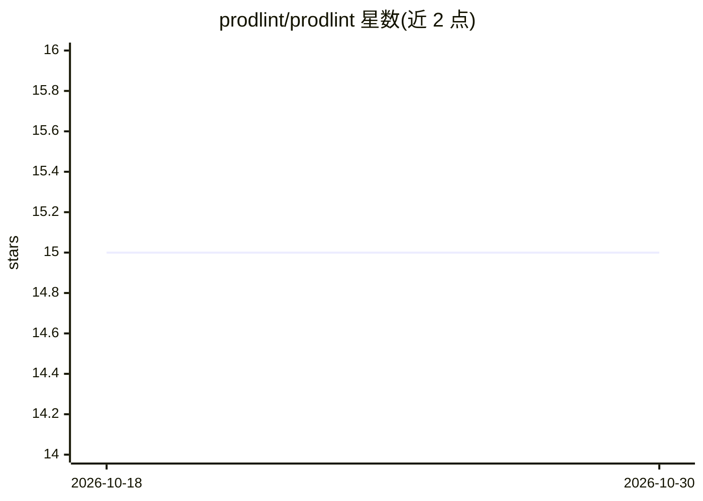

# prodlint/prodlint

⭐ 15 · TypeScript · MIT · 推送 2026-10-28 · [GitHub](https://github.com/prodlint/prodlint) · [官网](https://prodlint.com) · 组织维护

**面向 AI 生成代码的静态分析器：52 规则检测上线前问题**

针对 vibe-coded（AI 生成）应用的静态代码扫描 CLI：52 条规则分安全（27）、可靠性（11）、性能（6）、AI 质量（8）四类，检测硬编码密钥、缺失鉴权、幻觉导入、占位内容等问题。零配置、无需 LLM 调用，基于 Babel AST 解析配合正则回退，支持 monorepo 与 Prisma/Supabase 等框架感知的误报抑制。输出 0-100 加权评分，提供 GitHub Action、SARIF、基线机制、网站 agent 就绪检查（14 项）与内置 MCP Server，可在 Cursor/Claude Code 中调用扫描。

## 筛选速览

| 维度 | 判定 | 备注 |
|---|---|---|
| AI 角色 | `ai-enhanced` | 去掉 AI 部分产品仍成立 |
| 许可风险 | `permissive` | MIT |
| 部署形态 | `library` | 以包/库形式分发 |
| 模型依赖 | — | README 未给出锁定关系 |
| 硬件要求 | — | 无带数字的原话,不猜 |
| 安装摩擦 | `low` | 无编译、无系统依赖或容器化 |
| 成熟度 | — | 结构信号不足 |

## 能力要点

- 52 条规则覆盖安全/可靠性/性能/AI 质量，零配置无需 LLM
- Babel AST 解析 + monorepo/框架感知降低误报
- GitHub Action、SARIF、基线机制支持渐进式接入 CI
- 内置 MCP Server（scan/scan-web 工具）供编辑器 AI 调用

## 适用场景

- 上线前快速扫描 AI 生成的应用找硬编码密钥与缺失鉴权
- 在 PR 流水线中用 GitHub Action 自动评分并阻断严重问题
- 在 Cursor/Claude Code 里让 AI 助手直接调用扫描
- 检查已部署网站对 AI agent 的就绪度

## 场景标签

 · 领域:开发工具/代码质量

## 证据(README 行号)

> L9: Static analysis for vibe-coded apps. Flags the security, reliability, performance, and AI quality issues that Cursor
> L253: prodlint is designed specifically for AI-generated code patterns. Every rule checks for production issues that AI 

## 星数曲线

2026-10-18 15 → 2026-10-30 15（+0）

---
*卡片 v1 · prompt 1.4 · 生成 2026-10-30 · 置信度 high · 依据 README sha `233df4567c20` · [字段定义](../../DATASET.md)*
