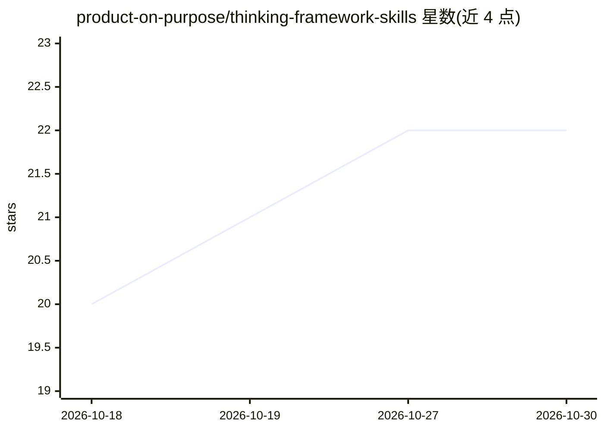

# product-on-purpose/thinking-framework-skills

⭐ 22 · JavaScript · Apache-2.0 · 推送 2026-10-26 · [GitHub](https://github.com/product-on-purpose/thinking-framework-skills) · [官网](https://product-on-purpose.github.io/thinking-framework-skills/) · 组织维护

**面向 AI agent 的结构化思维方法技能库（63 个框架，按证据分级）**

将结构化思维传统（决策科学、创造力研究、系统思维、前瞻、批判性思维）拆解为可组合的 agent 技能：每个框架提炼出机制、按七档证据等级（S/M/P/V/A/C/X）诚实标注、并产出具体工件（风险登记表、选项矩阵、论证图等）。共 63 个框架、4 个工具、9 个配方，提供 Framework Advisor 按情境推荐技能组合。技能均可脱离 agent 人工执行；每项标注适用边界与误用场景。可经 Claude Code 插件市场、开放 skills CLI（npx）或源码安装。

## 筛选速览

| 维度 | 判定 | 备注 |
|---|---|---|
| AI 角色 | `ai-knowledge` | 知识聚合/清单类 |
| 许可风险 | `permissive` | Apache-2.0 |
| 部署形态 | `library` | 以包/库形式分发 |
| 模型依赖 | — | README 未给出锁定关系 |
| 硬件要求 | — | 无带数字的原话,不猜 |
| 安装摩擦 | `low` | 无编译、无系统依赖或容器化 |
| 成熟度 | — | 结构信号不足 |

## 能力要点

- 63 个框架按 12 个认知操作族组织，附 4 个工具与 9 个配方链
- 七档证据分级（S/M/P/V/A/C/X），含人类研究迁移到 agent 的显式标注
- 每个技能产出具体工件（风险登记表、选项矩阵等）而非文字建议
- 七个'争议透镜'（SWOT、Five Whys 等）以警示优先方式收录，仅限显式请求使用

## 适用场景

- 在 Claude Code 等 agent 中按名称调用结构化思维技能（如 /think-premortem）
- 决策前生成风险登记表、选项矩阵等可复用工件
- 通过 Framework Advisor 用自然语言描述情境，获得技能执行计划
- 作为人类手工执行的思维流程模板

## 场景标签

`提示工程` · 领域:Agent 开发

## 证据(README 行号)

> L3: **An evidence-graded library of agent-executable thinking-method skills.**
> L31: `thinking-framework-skills` packages the durable core of the structured-thinking tradition (decision science, creat

## 星数曲线

2026-10-18 20 → 2026-10-30 22（+2）

---
*卡片 v1 · prompt 1.4 · 生成 2026-10-27 · 置信度 high · 依据 README sha `02315b8e6d81` · [字段定义](../../DATASET.md)*
