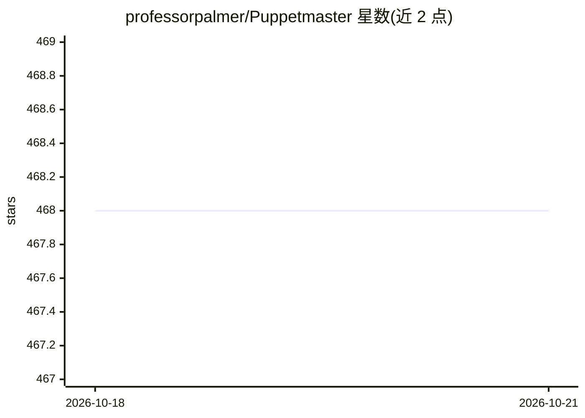

# professorpalmer/Puppetmaster

⭐ 470 · Python · MIT · 推送 2026-10-21 · [GitHub](https://github.com/professorpalmer/Puppetmaster) · 个人维护

**为开发者编排既有 agent CLI 的持久状态作业控制平面**

Puppetmaster 是一个监督者与作业存储层：通过 Cursor、Claude Code、Codex、Hermes、Antigravity 等 agent CLI 或 provider API 运行多步工程任务。它启动独立 worker、按可用模型路由任务、将带类型的结果写入 SQLite 以供检查与恢复，提供租约、artifacts、流图（可恢复节点与 map 扇出）、成本路由与仪表盘。面向需要持久状态与可审查输出的开发者，用于仓库调查、审计、重构与实现。安装为 pipx/pip 安装 puppetmaster-ai 后运行 puppetmaster setup 注册 MCP 工具；自述为 daily-driver beta（v1.27.21），定位在 LangGraph/CrewAI 等构建库之上协调既有 agent CLI。

## 筛选速览

| 维度 | 判定 | 备注 |
|---|---|---|
| AI 角色 | `ai-ecosystem` | LLM/agent 周边工具 |
| 许可风险 | `permissive` | MIT |
| 部署形态 | `library` | 以包/库形式分发 |
| 模型依赖 | — | README 未给出锁定关系 |
| 硬件要求 | — | 无带数字的原话,不猜 |
| 安装摩擦 | `low` | 无编译、无系统依赖或容器化 |
| 成熟度 | `idea` | |

## 能力要点

- 以 SQLite 为作业存储，支持检查、恢复与租约 worker
- 多平台适配器（cursor/claude-code/codex/hermes/antigravity/agentic 等）与 MCP pilot 模式
- 成本路由与持久重试（SWE-bench Lite 单种子研究：实际花费降低 29%）
- 流图、map 扇出、artifacts 证据字段与内容哈希、live 仪表盘

## 适用场景

- 让 Cursor/Claude Code 等 agent 承担仓库审计、调查与重构等监督式工程任务
- 跨多个 agent CLI 与 provider API 路由任务并控制成本
- 作业中断后从 SQLite 持久状态恢复并复查 artifacts 证据

## 场景标签

`Agent 框架` `多智能体` · 领域:Agent 开发

## 证据(README 行号)

> L8: Puppetmaster runs multi-step engineering work through the agent tools you already use: Cursor, Grok Bot, Claude Code
> L97: Puppetmaster is a supervisor and job store for agent CLIs and provider adapters. Grok Bot, Cursor Agent, Pi, and OM
> L117: Puppetmaster sits above libraries such as LangGraph and CrewAI: those libraries help you build an agent, while Pup

## 星数曲线

2026-10-18 468 → 2026-10-21 468（+0）

---
*卡片 v1 · prompt 1.4 · 生成 2026-10-22 · 置信度 high · 依据 README sha `4fff40c04ade` · [字段定义](../../DATASET.md)*
