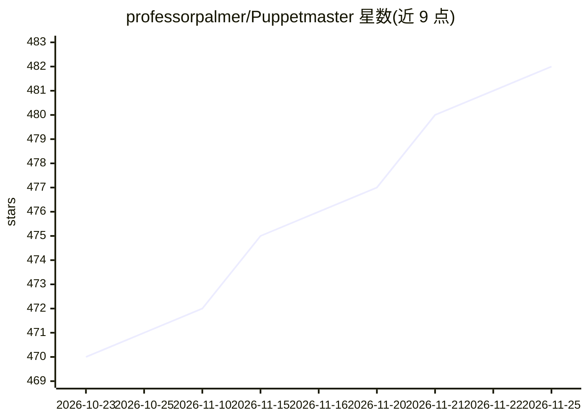

# professorpalmer/Puppetmaster

⭐ 482 · Python · MIT · 推送 2026-11-20 · [GitHub](https://github.com/professorpalmer/Puppetmaster) · 个人维护

**给 agent 编排工程任务的控制平面：持久化作业、worker 与结果管理**

以 Python 包与 CLI 形式提供的 agent 编排控制平面：将工程工作作为持久化作业运行，由 agent 提交任务后启动独立 subprocess worker，按路由策略分配到模型，将带类型的结果存入 SQLite；支持作业检查、恢复与事后读取结果（无需模型调用）。机制包括租约、artifacts、内存、确定性拼接摘要、并发会话与 worktree、预算限额、Dashboard 与 MCP 工具接口。文档含与 LangGraph、CrewAI 的对比章节及自述基准研究。

## 筛选速览

| 维度 | 判定 | 备注 |
|---|---|---|
| AI 角色 | `ai-ecosystem` | LLM/agent 周边工具 |
| 许可风险 | `permissive` | MIT |
| 部署形态 | `library` | 以包/库形式分发 |
| 模型依赖 | — | README 未给出锁定关系 |
| 硬件要求 | — | 无带数字的原话,不猜 |
| 安装摩擦 | `low` | 无编译、无系统依赖或容器化 |
| 成熟度 | — | 结构信号不足 |

## 能力要点

- 持久化作业：SQLite 存储、可恢复、事后读取结果无需模型调用
- worker 子进程 fan-out 与模型路由策略（model registry）
- MCP 工具安装（puppetmaster setup）与内置 agentic 适配器仅需 provider API key
- Dashboard 作业看板、CLI、移动端查看与预算限额

## 适用场景

- 把代码评审、实现等工程任务交给多个并行 agent worker 执行
- 长时间运行的 agent 任务需要可恢复的持久化状态
- 按成本路由模型并限制 agent 作业预算
- 通过 MCP 让 Claude Code/Codex 类工具提交与监控作业

## 场景标签

`Agent 框架` `多智能体` · 领域:Agent 开发

## 证据(README 行号)

> L8: Puppetmaster runs engineering work as durable jobs. It is universal for any harness or CLI, or a plain provider API.
> L10: Your agent gives Puppetmaster a task. Puppetmaster starts independent workers, routes each task to a model, and sto
> L18: puppetmaster setup               # installs MCP tools, rules, and hooks

## 星数曲线

2026-10-23 470 → 2026-11-25 482（+12）

---
*卡片 v1 · prompt 1.4 · 生成 2026-11-25 · 置信度 high · 依据 README sha `30e089d7e12a` · [字段定义](../../DATASET.md)*
