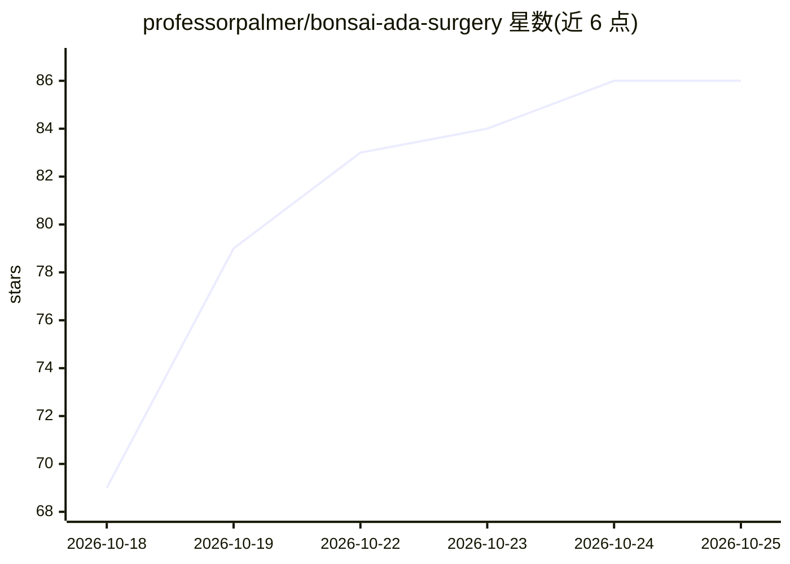

# professorpalmer/bonsai-ada-surgery

⭐ 88 · Python · NOASSERTION · 推送 2026-10-25 · [GitHub](https://github.com/professorpalmer/bonsai-ada-surgery) · [官网](https://github.com/professorpalmer/bonsai-ada-surgery/releases/latest) · 个人维护

**在 12/8 GB 消费级显卡上以全 262k 上下文运行 Bonsai 2 27B 的服务包**

围绕 PrismML 的 1.58-bit 三值模型 Bonsai 2 27B（PTQ1_0，5.9 GB）构建的本地推理服务包：内含修补过的 llama.cpp、按显卡自动配置 K/V 缓存的启动器（12 GB 用 q4_0、8 GB 用 q3_0）、MTP 投机解码起草与可选 agent 层（API 卡片、沙箱 Python）。权重本身不变，修复集中在运行时：effort 词、输出截断、模板默认值与工具调用解析（JSON 改为原生 XML+grammar，9/9）。Windows 提供 zip 包，含 OpenAI 兼容 API；Linux 与源码构建见 docs。限制：仅面向 NVIDIA 12/8 GB 显卡场景，权重需另行下载。

## 筛选速览

| 维度 | 判定 | 备注 |
|---|---|---|
| AI 角色 | `ai-ecosystem` | LLM/agent 周边工具 |
| 许可风险 | `none` | NOASSERTION |
| 部署形态 | `desktop` | 安装包/桌面程序 |
| 模型依赖 | local-ok | 支持本地模型 |
| 硬件要求 | — | 无带数字的原话,不猜 |
| 安装摩擦 | `low` | 无编译、无系统依赖或容器化 |
| 成熟度 | — | 结构信号不足 |

## 能力要点

- 12 GB 卡上以 q4_0 K/V 运行完整 262,144-token 上下文窗口
- 按显卡自动选择 K/V 缓存精度（q4_0 / q3_0）的启动器
- MTP 投机解码起草，12 GB 卡 4k 上下文解码 96.5 tok/s
- 工具调用从 JSON 解析 1/9 修复为原生 XML+grammar 9/9

## 适用场景

- 在 12 GB 或 8 GB 显卡上跑满 Bonsai 2 27B 的 262k 上下文
- 本地部署带 OpenAI 兼容 API 的推理服务供应用调用
- 让三值模型正确完成工具调用与推理 effort 控制

## 场景标签

`推理引擎` · 领域:训练与推理

## 证据(README 行号)

> L5: Ternary Bonsai 2 27B is PrismML's 1.58-bit ternary model (`PTQ1_0`, 5.9 GB). This repo serves it with the full
> L6: 262,144-token window on 12 GB and 8 GB NVIDIA cards. It has a patched PrismML llama.cpp,
> L20: 3. Run `.\start-server.ps1`. The OpenAI-compatible API is on `http://<host>:8080/v1`.

## 星数曲线

2026-10-18 69 → 2026-10-25 86（+17）

---
*卡片 v1 · prompt 1.4 · 生成 2026-10-24 · 置信度 high · 依据 README sha `25d54d30aa56` · [字段定义](../../DATASET.md)*
