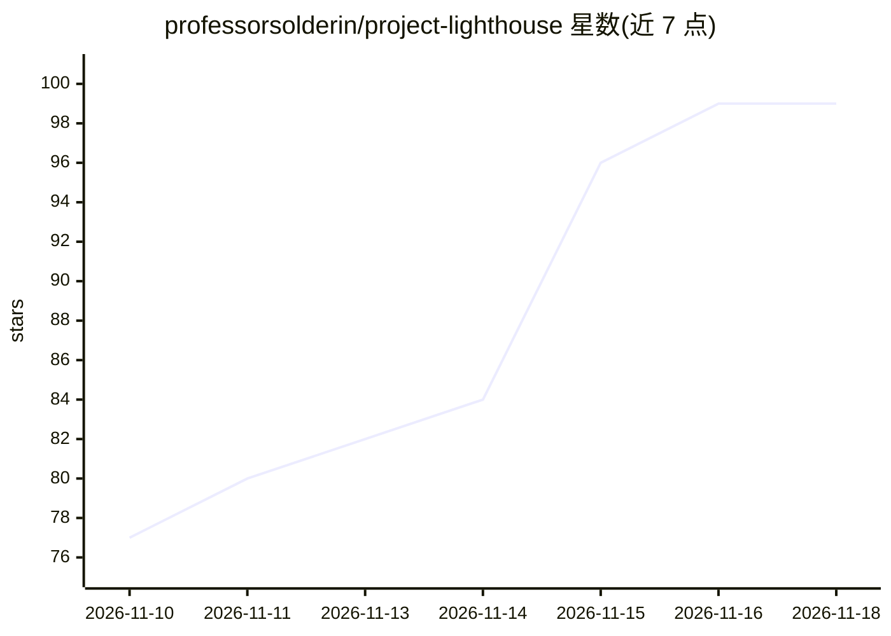

# professorsolderin/project-lighthouse

⭐ 99 · Python · NOASSERTION · 推送 2026-11-10 · [GitHub](https://github.com/professorsolderin/project-lighthouse) · 个人维护

**用 AI 批量研读历史科学手稿并产出候选发现的共享研究项目**

面向科学史研究者与贡献者的开放协作项目：对手稿图像做逐页转录（公式转 LaTeX），再做深度研读重建论证、标注现代等价结果与归属并给出意外性评分；候选发现须经四步核查协议（人读原件、代码重推数学、文献检索、无锚定独立复审），全部结果与被否决记录写入台账。已深读约 12,000 页（Gauss、Riemann、Hilbert 等），现存一条待古文字学家确认的 Riemann 激波手稿线索。每页成本约 $0.25，自带 Anthropic API key；转录按 CC BY 4.0、代码按 MIT 提供。

## 筛选速览

| 维度 | 判定 | 备注 |
|---|---|---|
| AI 角色 | `ai-native` | 本体是模型或模型工具 |
| 许可风险 | `none` | NOASSERTION |
| 部署形态 | `None` |  |
| 模型依赖 | locked-api |  |
| 硬件要求 | — | 无带数字的原话,不猜 |
| 安装摩擦 | `low` | 无编译、无系统依赖或容器化 |
| 成熟度 | — | 结构信号不足 |

## 能力要点

- 图像→逐字转录（LaTeX 公式、删改标记）→深度研读→意外性 0–10 评分的流水线
- 四步候选核查协议与十二类假阳性防护清单
- 台账记录所有候选含被否决者及否决来源
- 标签体系区分做了什么（transcribed/read/self-checked/reviewed/expert）而非相信什么

## 适用场景

- 我想让 AI 大规模转录并研读未被读过的历史手稿
- 我想核查某位历史科学家是否留下未被归属的结果
- 我想贡献转录、复审候选发现或给出专家裁定

## 场景标签

`科研工具` · 领域:学习与行业

## 证据(README 行号)

> L34: 1. **Transcribe** every page (image → verbatim text, formulas in LaTeX, struck text marked). `src/transcribe.py`
> L37:  who is credited, score 0–10 for how surprising it would be to a specialist. `src/deep.py`, `src/read_source.py`.
> L48: Cost: about $0.25 per page (transcription + deep read, Claude Opus 5.5). Bring your own API key

## 星数曲线

2026-11-10 77 → 2026-11-18 99（+22）

---
*卡片 v1 · prompt 1.4 · 生成 2026-11-17 · 置信度 high · 依据 README sha `0e6e715f774b` · [字段定义](../../DATASET.md)*
