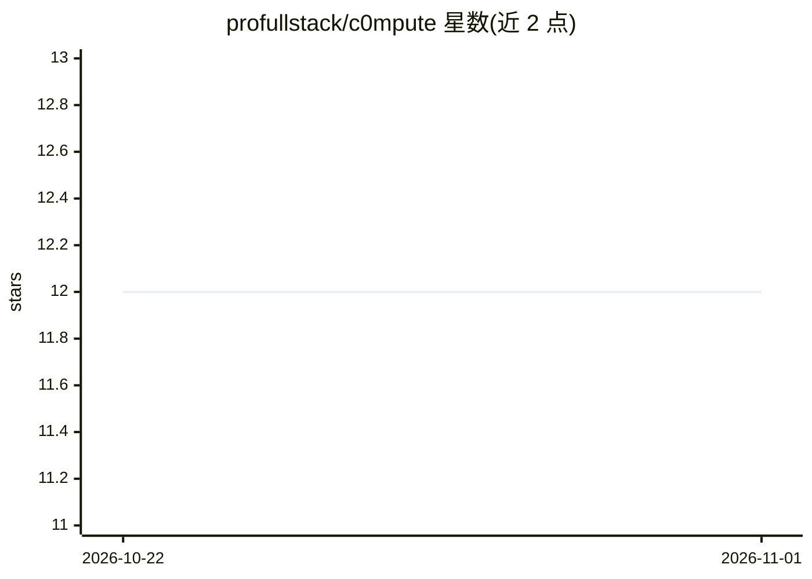

# profullstack/c0mpute

⭐ 12 · Rust · MIT · 推送 2026-10-31 · [GitHub](https://github.com/profullstack/c0mpute) · [官网](https://c0mpute.com) · 组织维护

**去中心化算力网络：一条命令跑节点，汇聚 CPU/GPU 服务开源模型推理**

Rust CLI 工具 c0mpute，通过一条 curl 安装命令加入 P2P 算力网络（libp2p Kad-DHT + gossipsub，无中心后端），节点对外承接三类负载：infernet AI 推理（自动发现本地模型、后台编译 llama.cpp 的 rpc-server 并注册为推理分片）、FFmpeg 转码和存储。身份用本地生成的 did:c0mpute，支付经 CoinPay（DID+托管）。支持 Linux/macOS/WSL2，检测并广播 NVIDIA/AMD/Apple GPU。README 自述多项功能尚未接通（CoinPay 托管、Infernet 运行时、libp2p 网络），付费需求处于早期。

## 筛选速览

| 维度 | 判定 | 备注 |
|---|---|---|
| AI 角色 | `ai-ecosystem` | LLM/agent 周边工具 |
| 许可风险 | `permissive` | MIT |
| 部署形态 | `None` |  |
| 模型依赖 | local-ok | 支持本地模型 |
| 硬件要求 | — | 无带数字的原话,不猜 |
| 安装摩擦 | `medium` | 含编译或系统依赖之一 |
| 成熟度 | `idea` | |

## 能力要点

- 一条 curl 命令安装并启动 worker（systemd 服务或后台守护进程）
- 分布式推理 IPIP-0033：自动注册模型为 RPC primary 并运行 llama.cpp rpc-server 分片
- 无中心后端：libp2p Kad-DHT + gossipsub 发现与调度，记录自带签名
- CoinPay DID + 托管结算，支持 16 种币或 PayPal 设置收款地址

## 适用场景

- 把闲置 CPU/GPU 机器加入去中心化网络承接推理/转码任务并获取报酬
- 在家用/NAS 环境部署长驻 systemd 算力节点
- 跨多节点分布式运行开源权重模型推理

## 场景标签

`推理引擎` · 领域:训练与推理

## 证据(README 行号)

> L30: - **What it does:** serves AI inference (through Infernet),
> L79: ### Distributed inference ("Distribute across all nodes") — automatic
> L86: 2. for each, resolves its GGUF (the Ollama blob is world-readable) and

## 星数曲线

2026-10-22 12 → 2026-11-01 12（+0）

---
*卡片 v1 · prompt 1.4 · 生成 2026-11-01 · 置信度 high · 依据 README sha `aeb14f18d959` · [字段定义](../../DATASET.md)*
