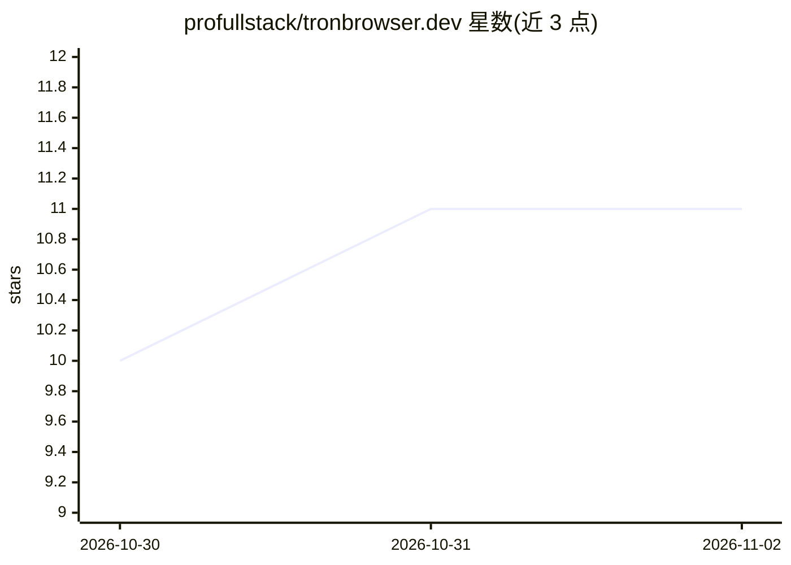

# profullstack/tronbrowser.dev

⭐ 11 · TypeScript · MIT · 推送 2026-10-31 · [GitHub](https://github.com/profullstack/tronbrowser.dev) · [官网](https://tronbrowser.dev) · 组织维护

**去谷歌化、隐私优先的 AI 浏览器（Ungoogled Chromium 分叉）**

基于 Ungoogled Chromium 的开源浏览器项目，原则为默认无遥测、无广告、无赞助标签页、数据归用户。当前通过安装脚本与 tron CLI 运行系统上的 Ungoogled Chromium/Chromium（隔离配置文件 + 去谷歌扩展），原生分叉二进制（约 50GB 构建）尚未编译完成。功能包括去谷歌新标签页与 pit.world 默认搜索、RSS 阅读器、自带 API key 的 AI 侧边栏（Anthropic/OpenAI/DeepSeek/Kimi/Qwen 或本地 Ollama/LM Studio/vLLM），以及面向 agent 的 tron automate MCP 服务器。MIT 许可，由 Profullstack, Inc. 维护。

## 筛选速览

| 维度 | 判定 | 备注 |
|---|---|---|
| AI 角色 | `ai-enhanced` | 去掉 AI 部分产品仍成立 |
| 许可风险 | `permissive` | MIT |
| 部署形态 | `library` | 以包/库形式分发 |
| 模型依赖 | local-ok | 支持本地模型 |
| 硬件要求 | — | 无带数字的原话,不猜 |
| 安装摩擦 | `low` | 无编译、无系统依赖或容器化 |
| 成熟度 | `idea` | |

## 能力要点

- BYOK AI 侧边栏，支持多家云端模型与本地 Ollama/LM Studio/vLLM
- tron CLI 与面向 agent 的 MCP 服务器（页面渲染 + 截图，Stdio/HTTP）
- 默认无遥测、无广告，扩展兼容，可自托管同步后端
- 多平台打包（macOS/Windows/deb/rpm/AUR/NixOS/Snap/Flatpak/AppImage 等）

## 适用场景

- 日常浏览但不想被谷歌遥测追踪
- 在浏览器侧边栏接入自己选择的云端或本地模型
- 给 agent 提供网页渲染与截图的 MCP 工具

## 场景标签

`AI 助手` · 领域:对话与助手

## 证据(README 行号)

> L3: Open-source, **privacy-first, AI-native** web browser — de-googled, built on
> L59: - **AI sidebar (bring your own keys)** — Anthropic, OpenAI, Google/Gemini,
> L60:  DeepSeek, Perplexity, Kimi, Qwen, or local (Ollama/LM Studio/vLLM).

## 星数曲线

2026-10-30 10 → 2026-11-02 11（+1）

---
*卡片 v1 · prompt 1.4 · 生成 2026-11-01 · 置信度 low · 依据 README sha `1f121d73401a` · [字段定义](../../DATASET.md)*
