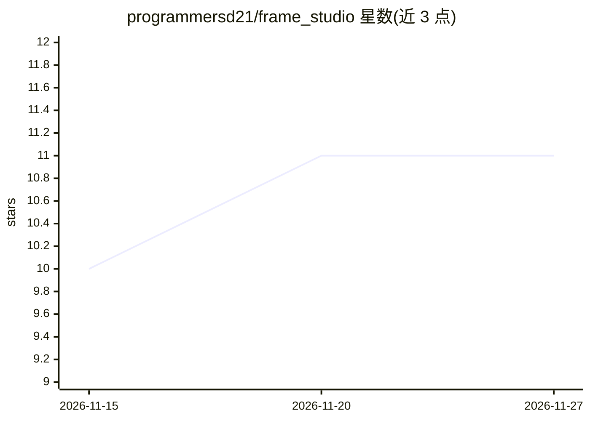

# programmersd21/frame_studio

⭐ 11 · TypeScript · 推送 2026-07-28 · [GitHub](https://github.com/programmersd21/frame_studio) · [官网](https://frame-studio-eta.vercel.app) · 个人维护

**输入提示词生成 Remotion 动效视频的 Web 应用**

基于 Next.js 与 Remotion 的动效视频生成工具：用户提供文本提示词，Gemini 生成视频结构与 React/Remotion 代码，经 TypeScript 沙箱校验与最多 3 次自动修复后，由服务端 esbuild 编译，浏览器内通过 WebCodecs 渲染 MP4 并直接下载，无需服务端渲染或 AWS。支持 8 个 Gemini 模型选择、时长/分辨率/宽高比预设、PDF 内容提取、SVG 数据可视化，账号体系基于 Supabase（认证、存储、视频历史）。部署到 Vercel 免费层，依赖 Node.js 18+ 与 pnpm。

## 筛选速览

| 维度 | 判定 | 备注 |
|---|---|---|
| AI 角色 | `ai-native` | 本体是模型或模型工具 |
| 许可风险 | `none` | — |
| 部署形态 | `library` | 以包/库形式分发 |
| 模型依赖 | — | README 未给出锁定关系 |
| 硬件要求 | — | 无带数字的原话,不猜 |
| 安装摩擦 | `low` | 无编译、无系统依赖或容器化 |
| 成熟度 | — | 结构信号不足 |

## 能力要点

- 提示词→代码→编译→浏览器内 MP4 渲染的端到端流程
- Gemini 自动修复编译错误（最多 3 次尝试）
- 支持 PDF 内容提取与 AI 生成的 SVG 图表/数据表
- 时长（5s–15m）、分辨率（720p–4K）、宽高比预设

## 适用场景

- 用自然语言快速生成动效演示视频
- 从多份 PDF 内容生成讲解视频
- 自托管部署一个视频生成站点并管理视频历史

## 场景标签

`视频生成` · 领域:内容生成

## 证据(README 行号)

> L5: AI motion graphics generator using React, Remotion, TypeScript, and Google Gemini API.
> L7: Provide a text prompt. Frame Studio generates a Remotion video project, compiles it, renders an MP4 **directly in yo
> L24: 6. Browser evaluates the code and renders MP4 using `@remotion/web-renderer`

## 星数曲线

2026-11-15 10 → 2026-11-27 11（+1）

---
*卡片 v1 · prompt 1.4 · 生成 2026-11-19 · 置信度 mid · 依据 README sha `02cd05593194` · [字段定义](../../DATASET.md)*
