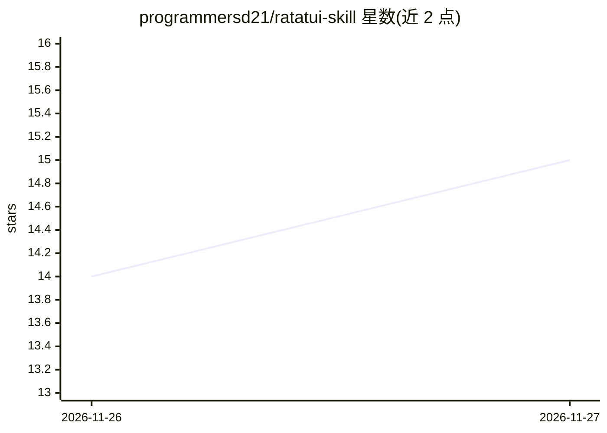

# programmersd21/ratatui-skill

⭐ 15 · Rust · MIT · 推送 2026-11-26 · [GitHub](https://github.com/programmersd21/ratatui-skill) · 个人维护

**让 AI 助手按当前 API 生成 ratatui 终端界面的 agent 技能**

一个面向 AI 编码助手的技能包：内置固定五步流程（查版本、写设计简报、从模板构建、验证、如实报告），约束助手使用当前 ratatui API、先写设计简报再写代码、并通过 fmt/clippy/测试/伪终端运行/生成痕迹扫描证明结果。附带经测试的 dirview 模板与 todo 示例。安装方式是把 skills/ratatui 目录复制到助手的 skills 目录；不加载技能但读取 AGENTS.md 的助手可用仓库根目录的简短版本。兼容任何能运行命令的助手。

## 筛选速览

| 维度 | 判定 | 备注 |
|---|---|---|
| AI 角色 | `ai-knowledge` | 知识聚合/清单类 |
| 许可风险 | `permissive` | MIT |
| 部署形态 | `None` |  |
| 模型依赖 | — | README 未给出锁定关系 |
| 硬件要求 | — | 无带数字的原话,不猜 |
| 安装摩擦 | `low` | 无编译、无系统依赖或容器化 |
| 成熟度 | — | 结构信号不足 |

## 能力要点

- 五步固定流程：版本查证→设计简报→模板构建→验证→报告
- lint-slop.sh 生成痕迹扫描，命中机械特征即 CI 失败
- 经测试的 dirview 模板：状态/渲染分离、单元与无头渲染测试
- AGENTS.md 短版本供不支持技能格式的助手使用

## 适用场景

- 让 Claude Code 或其他编码助手生成 ratatui 终端应用
- 避免助手凭记忆使用过时 ratatui API 和错误 crate 版本
- 为 TUI 项目获得包含布局、配色、按键的设计简报

## 场景标签

`编码 Agent` · 领域:编码与开发

## 证据(README 行号)

> L10:  Make your AI assistant write Ratatui apps that actually work.
> L29: **ratatui-skill** replaces that with a fixed process and a tested template. The assistant looks up what is current,
> L33: 1. Copy the skill into your assistant's skills directory. For Claude Code:

## 星数曲线

2026-11-26 14 → 2026-11-27 15（+1）

---
*卡片 v1 · prompt 1.4 · 生成 2026-11-26 · 置信度 high · 依据 README sha `2185e67fd64f` · [字段定义](../../DATASET.md)*
