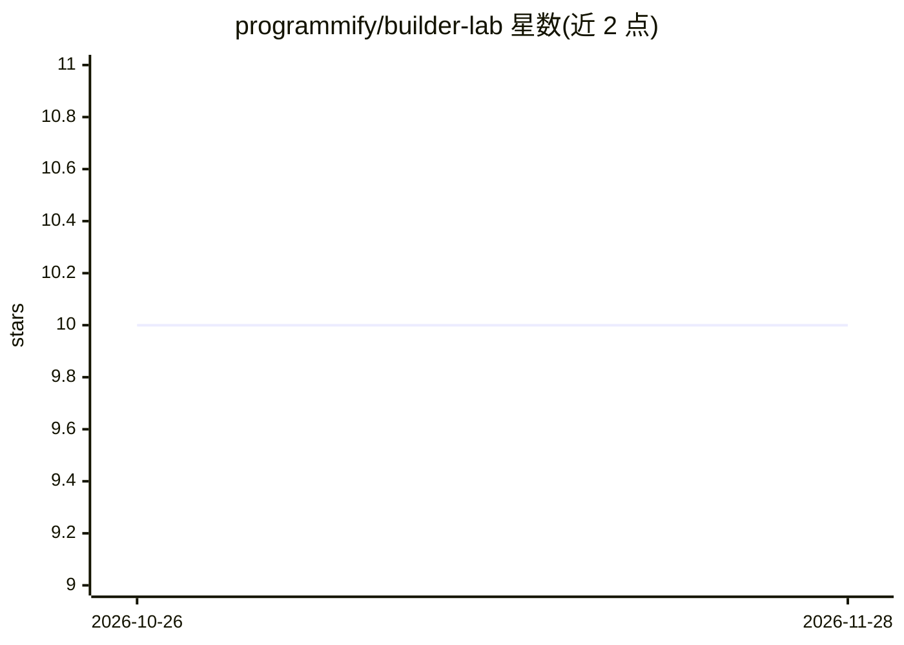

# programmify/builder-lab

⭐ 10 · TypeScript · NOASSERTION · 推送 2026-01-12 · [GitHub](https://github.com/programmify/builder-lab) · [官网](https://builderlab.programmify.org) · 组织维护

**面向开发者的 AI 与开发工具分类目录站**

由 /data/ 数据文件自动生成的工具目录页面，按五个类别组织条目：AI 与 LLM API（29 条）、Vibe Coding 工具（14 条）、开发者工具（27 条）、移动应用构建器（14 条）、设计与视频制作（22 条）。每条以表格形式列出名称、描述、定价类型、文档链接、标签和流行度标注。技术栈基于 React/TypeScript/Tailwind/shadcn。README 本身不含安装命令或运行说明，仅展示由数据生成的清单内容。

## 筛选速览

| 维度 | 判定 | 备注 |
|---|---|---|
| AI 角色 | `ai-knowledge` | 知识聚合/清单类 |
| 许可风险 | `none` | NOASSERTION |
| 部署形态 | `None` |  |
| 模型依赖 | — | README 未给出锁定关系 |
| 硬件要求 | — | 无带数字的原话,不猜 |
| 安装摩擦 | `low` | 无编译、无系统依赖或容器化 |
| 成熟度 | — | 结构信号不足 |

## 能力要点

- 五个类别共 106 个工具条目，自动从 /data/ 数据文件生成
- 每条条目标注定价类型（Free/Freemium/Paid/Open Source）与 Docs 链接
- 涵盖 LLM API 网关、本地推理、agent 框架、低代码平台等类型

## 适用场景

- 快速查找构建项目可用的 AI API 和开发工具
- 按定价类型和用途浏览工具选型参考
- 了解 vibe coding 和低代码工具生态的组成

## 场景标签

`精选清单` · 领域:学习与行业

## 证据(README 行号)

> L3: Automatically generated from the data files in `/data/`.
> L5: ## AI & LLM APIs (29)

## 星数曲线

2026-10-26 10 → 2026-11-28 10（+0）

---
*卡片 v1 · prompt 1.4 · 生成 2026-11-19 · 置信度 high · 依据 README sha `72dd2aa35c0f` · [字段定义](../../DATASET.md)*
