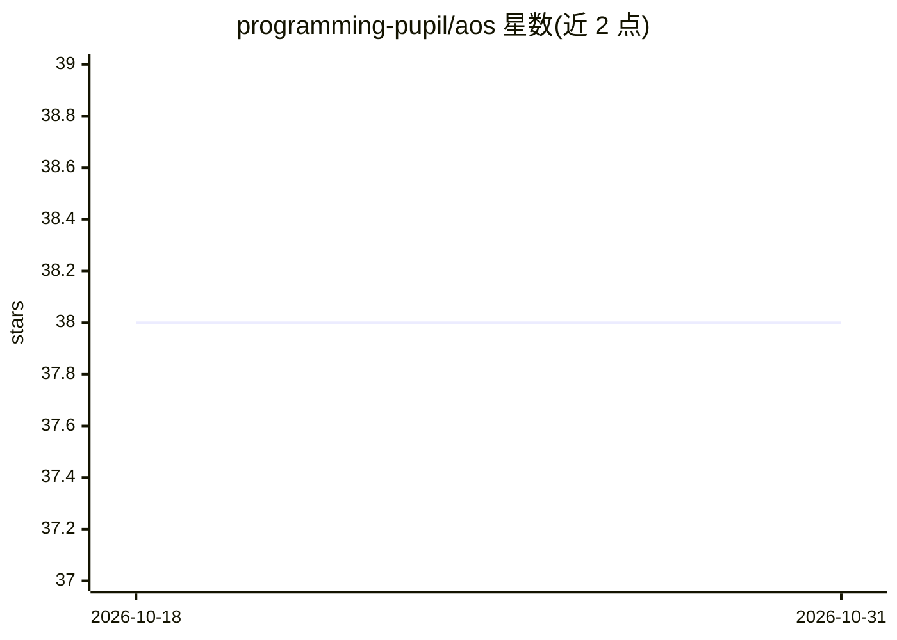

# programming-pupil/aos

⭐ 38 · Rust · NOASSERTION · 推送 2026-10-25 · [GitHub](https://github.com/programming-pupil/aos) · 个人维护 · 中文 README

**Web 优先的多租户 Agent 操作系统，构建可恢复的 Agent 工作流**

AOS（Agent Operating System）是以 Rust WebServer + SQLite 为控制平面的多租户 Web 工作区，围绕一个可恢复的 Agent 会话组织工作：对话与长任务恢复、带证据核查与执行上限的深度研究、面向外部数据源的 NL2SQL 数据问答、通过 Bot Gateway 适配器接入聊天平台的移动访问，以及将产品请求转为设计文档与任务分解的渐进式工程设计流程；Skills 与 MCP 为可选扩展，安装时按不可信输入处理并施加权限边界。项目处于活跃源码发布与回归测试阶段，离线发行包仅在构建完成后附于 GitHub Releases；贡献者路径为 Docker Compose，或本地脚本启动，需在系统内配置模型 API Key 才能执行提供商相关工作。

## 筛选速览

| 维度 | 判定 | 备注 |
|---|---|---|
| AI 角色 | `ai-ecosystem` | LLM/agent 周边工具 |
| 许可风险 | `none` | NOASSERTION |
| 部署形态 | `self-host` | docker 或自建部署 |
| 模型依赖 | — | README 未给出锁定关系 |
| 硬件要求 | — | 无带数字的原话,不猜 |
| 安装摩擦 | `low` | 无编译、无系统依赖或容器化 |
| 成熟度 | `idea` | |

## 能力要点

- 单一可恢复 Agent 会话：长任务状态持久化，客户端重连可恢复上下文
- 深度研究带证据核查、执行上限与可用的回退答案
- 数据源感知的 NL2SQL、语义检索与数据溯源工作流
- Bot Gateway 适配器将 Agent 接入外部聊天平台并投递通知

## 适用场景

- 在自托管工作区中运行可审计、可恢复的 Agent 长任务
- 对业务数据库做自然语言查询并追踪 SQL 溯源
- 通过手机聊天平台访问 Agent 并接收任务通知

## 场景标签

`Agent 框架` `数据分析` · 领域:Agent 开发

## 证据(README 行号)

> L15: AOS means **Agent Operating System**: a Web-first, multi-tenant workspace for building useful Agent workflows aroun
> L43:  +--> Agent runtime and recoverable sessions

## 星数曲线

2026-10-18 38 → 2026-10-31 38（+0）

---
*卡片 v1 · prompt 1.4 · 生成 2026-10-25 · 置信度 high · 依据 README sha `a41a6454de50` · [字段定义](../../DATASET.md)*
