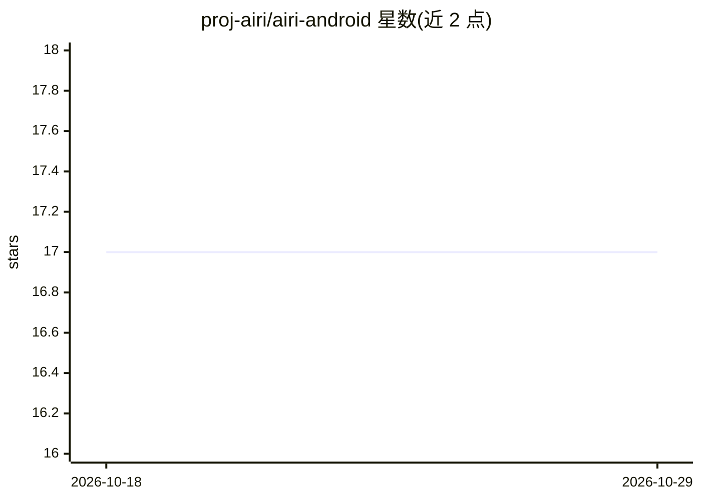

# proj-airi/airi-android

⭐ 17 · TypeScript · MIT · 推送 2026-01-14 · [GitHub](https://github.com/proj-airi/airi-android) · 组织维护

**让 LLM 通过 MCP 控制安卓设备的 MCP 服务器**

airi 项目的子项目，一个基于 MCP 协议的服务器，使 LLM/agent 能够控制安卓设备：提供输入操作（点击/滑动/输入文本/按键）、设备信息读取（屏幕尺寸/CPU/电池）、UI 层级与 Activity 查询、设备连接管理与任意 shell 命令执行等工具。基于 Bun/TypeScript 实现，使用 adbkit 作为 ADB 客户端、Hono 提供 Web 服务。推荐以 Docker 运行（支持 SSE 与 stdio 两种传输模式），也可本地用 Bun 直接运行；开发需安装 Bun 与 Android Platform Tools。

## 筛选速览

| 维度 | 判定 | 备注 |
|---|---|---|
| AI 角色 | `ai-ecosystem` | LLM/agent 周边工具 |
| 许可风险 | `permissive` | MIT |
| 部署形态 | `self-host` | docker 或自建部署 |
| 模型依赖 | — | README 未给出锁定关系 |
| 硬件要求 | — | 无带数字的原话,不猜 |
| 安装摩擦 | `low` | 无编译、无系统依赖或容器化 |
| 成熟度 | — | 结构信号不足 |

## 能力要点

- 输入控制工具：tap/swipe/text/keyevent/roll
- 读取屏幕尺寸、CPU、电池、UI 层级、Activity 等设备信息
- 支持 device_connect/device_reset 与任意 shell 命令执行
- Docker 运行，支持 SSE 与 stdio 两种 MCP 传输模式

## 适用场景

- 让 MCP 客户端的 AI agent 操作我的安卓设备进行自动化测试
- 通过 LLM 读取设备状态与 UI 层级做界面分析
- 远程连接模拟器或多台安卓设备进行批量控制

## 场景标签

`GUI 自动化` · 领域:效率与自动化

## 证据(README 行号)

> L5: A MCP server that allows ~~airi~~ all LLMs to control Android devices. This project is a child project of airi.
> L96: - MCP SDK - Model Context Protocol SDK

## 星数曲线

2026-10-18 17 → 2026-10-29 17（+0）

---
*卡片 v1 · prompt 1.4 · 生成 2026-10-29 · 置信度 high · 依据 README sha `09dfa951cb36` · [字段定义](../../DATASET.md)*
