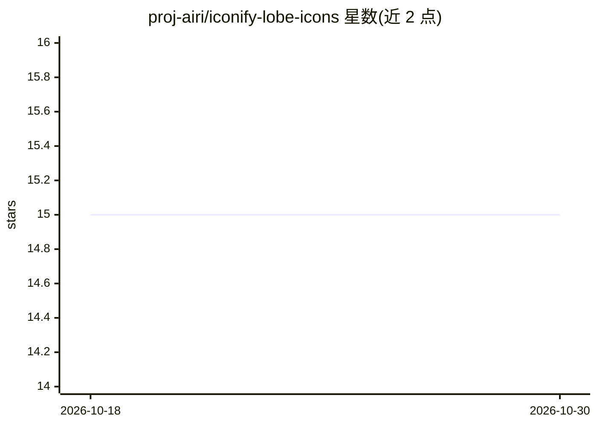

# proj-airi/iconify-lobe-icons

⭐ 15 · TypeScript · MIT · 推送 2026-04-14 · [GitHub](https://github.com/proj-airi/iconify-lobe-icons) · [官网](https://iconify.ayaka.io/collection/@proj-airi/lobe-icons) · 组织维护

**AI/LLM 品牌图标集的 Iconify 移植，供 UnoCSS 等使用**

将 @lobehub 的 lobe-icons 图标资源打包为 Iconify 兼容的 npm 包，内容为常见 AI/LLM 模型品牌的 SVG Logo 与图标集合，可在 lobehub.com/icons 单页浏览。通过 @iconify/utils 的外部包图标加载器与 UnoCSS presetIcons 集成，用 i- 前缀语法在 HTML/CSS 中引用图标；也可用于任何 Iconify 兼容场景。属于 Project AIRI 的关联项目，贡献与请求在原 lobe-icons 仓库进行。

## 筛选速览

| 维度 | 判定 | 备注 |
|---|---|---|
| AI 角色 | `ai-ecosystem` | LLM/agent 周边工具 |
| 许可风险 | `permissive` | MIT |
| 部署形态 | `library` | 以包/库形式分发 |
| 模型依赖 | — | README 未给出锁定关系 |
| 硬件要求 | — | 无带数字的原话,不猜 |
| 安装摩擦 | `low` | 无编译、无系统依赖或容器化 |
| 成熟度 | — | 结构信号不足 |

## 能力要点

- AI/LLM 模型品牌 SVG 图标集合
- Iconify 兼容，可用于 UnoCSS 等 Iconify 场景
- 以 npm 包 @proj-airi/lobe-icons 分发，支持 ni/pnpm/yarn/npm 安装

## 适用场景

- 在前端项目中引用各 AI 模型品牌图标
- 配合 UnoCSS presetIcons 用 i- 语法使用图标

## 场景标签

 · 领域:前端/UI 资源

## 证据(README 行号)

> L9: Popular AI / LLM Model Brand SVG Logo and Icon Collection. See them all on one page at lobehub.com/icons.
> L12: This enables you to use Lobe Icons in UnoCSS or any Iconify compatible scenario.

## 星数曲线

2026-10-18 15 → 2026-10-30 15（+0）

---
*卡片 v1 · prompt 1.4 · 生成 2026-10-30 · 置信度 mid · 依据 README sha `7f1b9891129e` · [字段定义](../../DATASET.md)*
