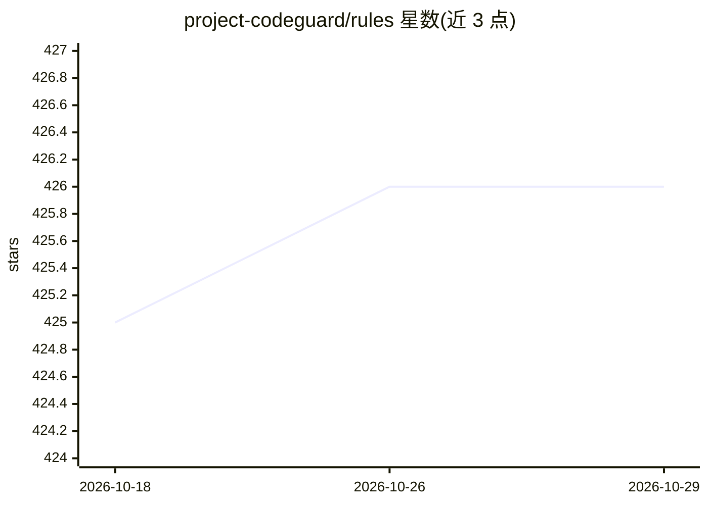

# project-codeguard/rules

⭐ 426 · Python · NOASSERTION · 推送 2026-01-29 · [GitHub](https://github.com/project-codeguard/rules) · [官网](https://project-codeguard.org) · 组织维护

**面向 AI 编码工作流的安全规则框架，已移交 CoSAI 维护**

Project CodeGuard 是模型无关的安全框架与规则集，将默认安全实践嵌入 AI 编码的生成与评审流程；提供核心安全规则、面向主流编码 agent 的转换器和测试规则合规性的验证器。当前 README 仅声明项目已捐赠给 Coalition for Secure AI（CoSAI）并迁移至新仓库，本仓库不再更新；功能细节与参与方式需访问新仓库获取。

## 筛选速览

| 维度 | 判定 | 备注 |
|---|---|---|
| AI 角色 | `ai-ecosystem` | LLM/agent 周边工具 |
| 许可风险 | `none` | NOASSERTION |
| 部署形态 | `None` |  |
| 模型依赖 | — | README 未给出锁定关系 |
| 硬件要求 | — | 无带数字的原话,不猜 |
| 安装摩擦 | `low` | 无编译、无系统依赖或容器化 |
| 成熟度 | — | 结构信号不足 |

## 能力要点

- 模型无关的安全规则框架，覆盖代码生成与评审环节
- 提供核心安全规则、编码 agent 转换器与合规验证器

## 适用场景

- 为 AI 编码 agent 配置默认安全规则
- 测试 AI 生成代码对安全规则的合规性

## 场景标签

`网络安全` `代码审查` · 领域:编码与开发

## 证据(README 行号)

> L1: ## Project CodeGuard has been donated to the Coalition for Secure AI (CoSAI)!
> L3: This project is now maintained by the Coalition for Secure AI (CoSAI).

## 星数曲线

2026-10-18 425 → 2026-10-29 426（+1）

---
*卡片 v1 · prompt 1.4 · 生成 2026-10-21 · 置信度 low · 依据 README sha `1476e7d7a551` · [字段定义](../../DATASET.md)*
