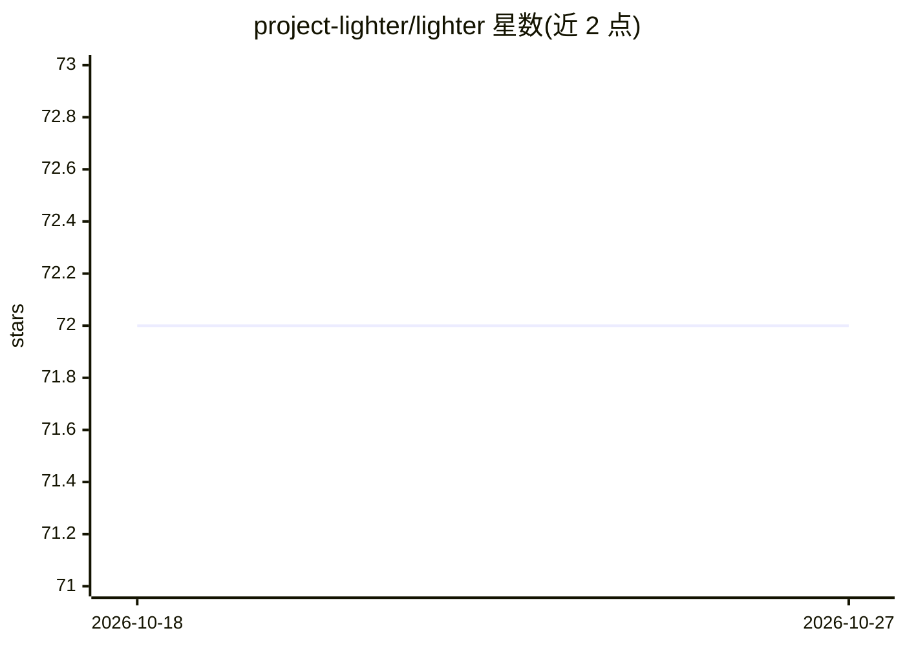

# project-lighter/lighter

⭐ 72 · Python · MIT · 推送 2026-10-18 · [GitHub](https://github.com/project-lighter/lighter) · [官网](https://project-lighter.github.io/lighter) · 组织维护

**用 YAML 配置驱动 PyTorch Lightning 深度学习实验的框架**

面向已使用 PyTorch Lightning 的深度学习研究者的配置框架：将超参数、trainer、模型等写入 YAML，通过 CLI 覆盖任意参数而不改代码，实现实验可复现与可组合（合并配置、共享实验文件）。兼容任意 PyTorch Lightning 模块，可选 LighterModule 提供自动 optimizer 配置与双重日志以减少样板代码。核心约 500 行代码，自动生成带时间戳的输出目录。以 pip 包提供，有 JOSS 论文，医学影像基础模型研究中有实际使用。

## 筛选速览

| 维度 | 判定 | 备注 |
|---|---|---|
| AI 角色 | `ai-ecosystem` | LLM/agent 周边工具 |
| 许可风险 | `permissive` | MIT |
| 部署形态 | `library` | 以包/库形式分发 |
| 模型依赖 | — | README 未给出锁定关系 |
| 硬件要求 | — | 无带数字的原话,不猜 |
| 安装摩擦 | `low` | 无编译、无系统依赖或容器化 |
| 成熟度 | — | 结构信号不足 |

## 能力要点

- YAML 配置 + CLI 覆盖超参数，无需改代码
- 兼容任意 PyTorch Lightning 模块，零锁定
- LighterModule 提供自动 optimizer 配置与 step/epoch 双重日志
- 核心约 500 行代码，自动时间戳输出目录

## 适用场景

- 把 PyTorch Lightning 实验的超参数改为配置文件管理
- 从命令行跑学习率/批大小网格搜索
- 用版本控制管理实验配置以复现结果

## 场景标签

`MLOps` · 领域:训练与推理

## 证据(README 行号)

> L10: **Lighter** makes PyTorch Lightning experiments reproducible and composable through YAML configuration. Stop hardco
> L14: You're already using PyTorch Lightning. But every experiment requires editing Python code to change hyperparameters

## 星数曲线

2026-10-18 72 → 2026-10-27 72（+0）

---
*卡片 v1 · prompt 1.4 · 生成 2026-10-24 · 置信度 high · 依据 README sha `6cbf112afa3a` · [字段定义](../../DATASET.md)*
