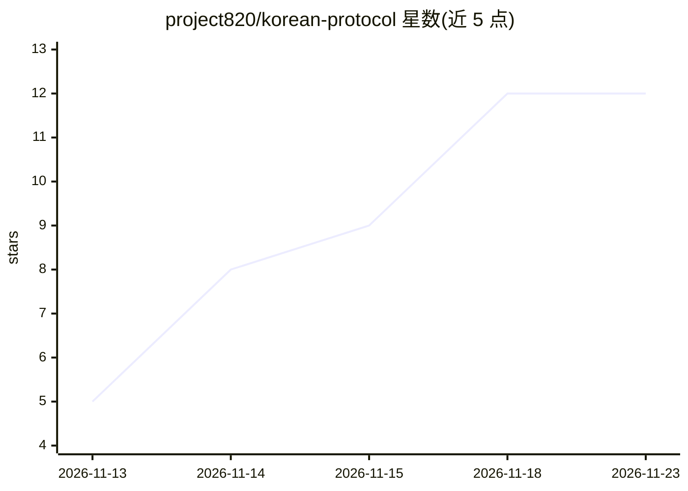

# project820/korean-protocol

⭐ 12 · Python · MIT · 推送 2026-11-13 · [GitHub](https://github.com/project820/korean-protocol) · [官网](https://github.com/project820/korean-protocol/blob/main/INSTALL.md) · 个人维护

**让 LLM 韩语回答明确传达对象·条件·期限的写作规范（Codex/Claude Code 技能）**

从 ASD-STE100 出发的独立韩语写作规范，封装为 Codex 与 Claude Code 的按需调用技能（$korean-protocol / /korean-protocol），在保持原资料语义的前提下重排段落与句子，使读者能直接找到对象、判断、条件、期限。定义 L1~L4 四级输出形式（文本、表格/Mermaid、单文件 HTML、Manim 代码），含参考文件读取义务与 HTML 诊断脚本。README 附带多轮形式合规诊断数据，并声明原文·KP·STE 正式对比未完成；安装为手动进行，无自动更新器。MIT 许可（自写部分）。

## 筛选速览

| 维度 | 判定 | 备注 |
|---|---|---|
| AI 角色 | `ai-knowledge` | 知识聚合/清单类 |
| 许可风险 | `permissive` | MIT |
| 部署形态 | `None` |  |
| 模型依赖 | — | README 未给出锁定关系 |
| 硬件要求 | — | 无带数字的原话,不猜 |
| 安装摩擦 | `low` | 无编译、无系统依赖或容器化 |
| 成熟度 | — | 结构信号不足 |

## 能力要点

- 以 SKILL.md 形式提供，按用户范围安装后可跨项目调用
- L1~L4 四级输出规范：文本/表格·Mermaid/单文件 HTML/Manim
- 附 HTML 诊断脚本 check_html.py 及形式合规评估记录
- 对 Codex 与 Claude Code 双宿主提供调用指令

## 适用场景

- 在 Codex/Claude Code 中整理韩语通知、报告时保留对象·条件·期限
- 需要将韩语原文改写为分项、条件分组、期限例外清晰的输出
- 复用其 L3 规范生成无外部依赖的单文件说明页面

## 场景标签

`提示工程` · 领域:Agent 开发

## 证据(README 行号)

> L7: Korean Protocol(KP)은 Codex·Claude Code에서 **필요할 때 호출하는 한국어 작성 스킬**이다. 원자료의 뜻을 유지하며 배치와 문장을 다듬는다.
> L11: |현재 버전|**v0.11.1** · 호출형 스킬 · 읽는 형태와 L1~L4 출력 형식|
> L19: ## v0.11.1은 L1~L4 출력 지침을 정의했다

## 星数曲线

2026-11-13 5 → 2026-11-23 12（+7）

---
*卡片 v1 · prompt 1.4 · 生成 2026-11-18 · 置信度 high · 依据 README sha `fa186d51adcd` · [字段定义](../../DATASET.md)*
