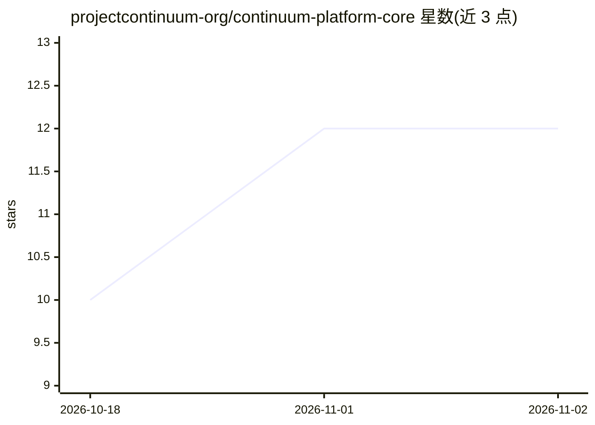

# projectcontinuum-org/continuum-platform-core

⭐ 12 · Kotlin · Apache-2.0 · 推送 2026-10-30 · [GitHub](https://github.com/projectcontinuum-org/continuum-platform-core) · [官网](https://projectcontinuum.org) · 组织维护

**云端可视化工作流引擎核心后端：跑 ML/化学/ETL 流程，崩溃可恢复**

Project Continuum 的核心后端 monorepo，提供 API 服务器（管理工作流、节点注册、执行）、Spring Boot worker 起步库（向 Temporal 自动注册节点）、Kafka→MQTT 事件桥、共享库与 Avro schema。执行由 Temporal 提供持久化，节点间以 Parquet 传递数据，浏览器端 IDE 与功能节点（含 Unsloth LLM 微调、RDKit 化学节点）在其他仓库。面向需要自托管、可扩展分布式工作流的开发者；依赖 Kafka/Temporal/S3(MinIO) 等基础设施，多 worker 架构按能力独立部署。Apache 2.0 许可。

## 筛选速览

| 维度 | 判定 | 备注 |
|---|---|---|
| AI 角色 | `ai-ecosystem` | LLM/agent 周边工具 |
| 许可风险 | `permissive` | Apache-2.0 |
| 部署形态 | `self-host` | docker 或自建部署 |
| 模型依赖 | — | README 未给出锁定关系 |
| 硬件要求 | — | 无带数字的原话,不猜 |
| 安装摩擦 | `low` | 无编译、无系统依赖或容器化 |
| 成熟度 | `idea` | |

## 能力要点

- Temporal 持久化执行：工作流在进程崩溃、重启后可恢复
- Kafka→MQTT/WebSocket 实时流式推送节点执行状态到浏览器
- 节点间以 Apache Parquet 列式表传递数据
- 多 worker 架构：能力以独立 worker 扩展，其余 worker 零停机

## 适用场景

- 在浏览器中拖拽搭建 ML 训练/推理或数据 ETL 流程
- 需要流程在基础设施故障后仍继续运行的场景
- 通过编写自定义 worker 添加领域节点（如化学、AI）接入共享注册表

## 场景标签

`工作流自动化` · 领域:效率与自动化

## 证据(README 行号)

> L31: |continuum-feature-ai|AI/ML nodes — LLM fine-tuning with Unsloth + LoRA|
> L88: |🧪|**AI / ML Ready**|Train models with Unsloth, run inference, all inside your flow|
> L117:  ↑ Fine-tune LLMs with Unsloth — right inside your workflow graph.

## 星数曲线

2026-10-18 10 → 2026-11-02 12（+2）

---
*卡片 v1 · prompt 1.4 · 生成 2026-11-01 · 置信度 high · 依据 README sha `b8b42292c336` · [字段定义](../../DATASET.md)*
