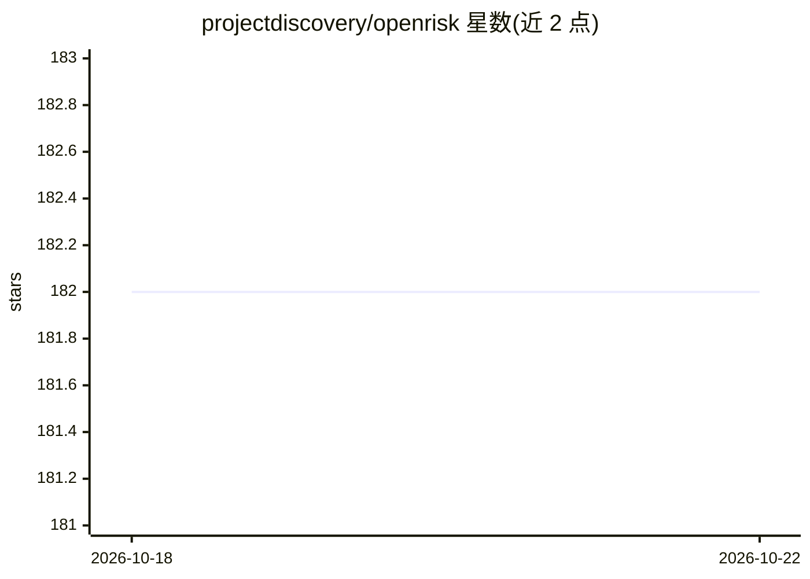

# projectdiscovery/openrisk

⭐ 182 · Go · MIT · 推送 2026-10-21 · [GitHub](https://github.com/projectdiscovery/openrisk) · 组织维护

**读取 Nuclei 扫描结果并用 GPT-4o 生成主机风险评分的工具**

ProjectDiscovery Research Team 发布的实验性安全工具：读取 nuclei 扫描输出（text、markdown、JSON 三种格式），调用 OpenAI GPT-4o 模型为目标主机生成风险评分。目前一次仅针对单一目标。运行需设置 OPENAI_API_KEY，通过 go install 安装（要求 go1.20），也可作为 Go 库调用（Options + GetScore）。README 声明为实验性项目，可能不满足团队其他项目的代码质量标准。

## 筛选速览

| 维度 | 判定 | 备注 |
|---|---|---|
| AI 角色 | `ai-native` | 本体是模型或模型工具 |
| 许可风险 | `permissive` | MIT |
| 部署形态 | `library` | 以包/库形式分发 |
| 模型依赖 | — | README 未给出锁定关系 |
| 硬件要求 | — | 无带数字的原话,不猜 |
| 安装摩擦 | `low` | 无编译、无系统依赖或容器化 |
| 成熟度 | `idea` | |

## 能力要点

- 读取 nuclei 的 text/markdown/JSON 格式扫描结果
- 调用 OpenAI GPT-4o 生成主机风险评分
- 提供 CLI 与 Go 库两种使用方式
- 自声明实验性项目，当前仅支持单目标

## 适用场景

- 对 nuclei 扫描结果快速生成风险评分
- 在自动化安全评估流程中引入 LLM 生成风险结论
- 以 Go 库形式集成到自有安全工具链

## 场景标签

 · 领域:网络安全

## 证据(README 行号)

> L3: openrisk is an experimental tool which reads nuclei output (text, markdown, and JSON) and generates a risk score for
> L5: > **NOTE**: This is an experimental program released by the ProjectDiscovery Research Team. As such, it may not meet

## 星数曲线

2026-10-18 182 → 2026-10-22 182（+0）

---
*卡片 v1 · prompt 1.4 · 生成 2026-10-22 · 置信度 high · 依据 README sha `ac5a5ae3e6ad` · [字段定义](../../DATASET.md)*
