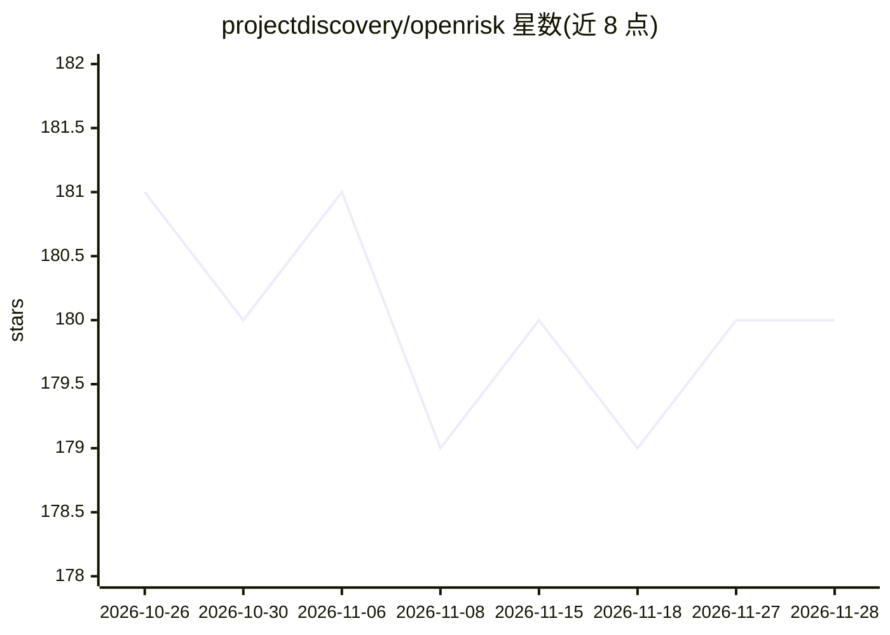

# projectdiscovery/openrisk

⭐ 180 · Go · MIT · 推送 2026-11-27 · [GitHub](https://github.com/projectdiscovery/openrisk) · 组织维护

**读取 Nuclei 扫描结果并用 OpenAI 模型生成主机风险评分**

ProjectDiscovery Research Team 发布的实验性工具：读取 Nuclei 扫描输出（支持文本、Markdown、JSON 格式），调用 OpenAI GPT 模型对单个目标主机生成风险评分。需设置 OPENAI_API_KEY 方可运行；需 Go 1.26.10 安装，命令行使用，也可作为 Go 库使用（通过 Options 结构、OpenRisk 与 IssueProcessor 对象及 GetScore 函数）。README 自述为实验程序，代码质量与测试程度可能低于该团队其他项目。

## 筛选速览

| 维度 | 判定 | 备注 |
|---|---|---|
| AI 角色 | `ai-native` | 本体是模型或模型工具 |
| 许可风险 | `permissive` | MIT |
| 部署形态 | `library` | 以包/库形式分发 |
| 模型依赖 | — | README 未给出锁定关系 |
| 硬件要求 | — | 无带数字的原话,不猜 |
| 安装摩擦 | `low` | 无编译、无系统依赖或容器化 |
| 成熟度 | `idea` | |

## 能力要点

- 读取 Nuclei 扫描的文本/Markdown/JSON 输出并生成风险评分
- 可作为 Go 库集成（Options/OpenRisk/IssueProcessor/GetScore）
- 每次针对单个目标运行

## 适用场景

- 对 Nuclei 扫描结果生成主机风险评分
- 在 Go 程序中以库方式集成风险评分功能

## 场景标签

`网络安全` · 领域:学习与行业

## 证据(README 行号)

> L3: openrisk is an experimental tool which reads nuclei output (text, markdown, and JSON) and generates a risk score for
> L11: go install -v github.com/projectdiscovery/openrisk@latest

## 星数曲线

2026-10-26 181 → 2026-11-28 180（-1）

---
*卡片 v1 · prompt 1.4 · 生成 2026-11-27 · 置信度 high · 依据 README sha `fd9e9de44d52` · [字段定义](../../DATASET.md)*
